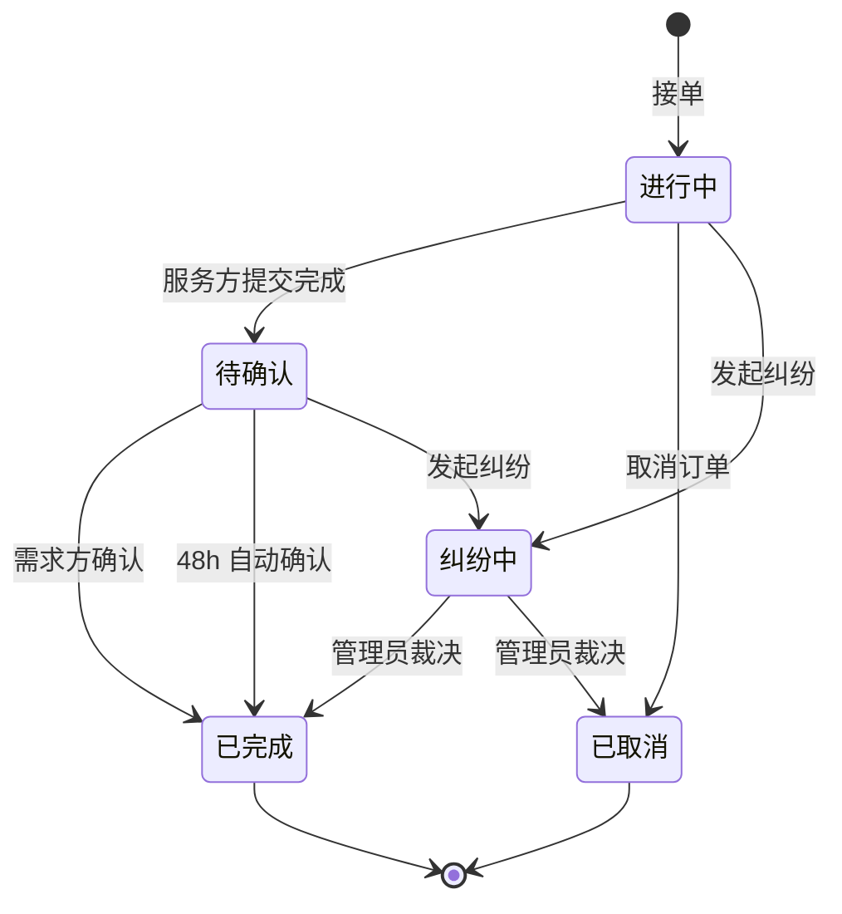

# API 设计文档

**CampusHub 校园互助服务平台**

| 版本 | 日期 | 作者 | 说明 |
| --- | --- | --- | --- |
| 1.0 | 2026-05-12 | AI 生成 | 基于需求规格说明书和架构设计文档生成 |

> 对应**任务 2.1 API 规范文档**。完整 OpenAPI 3.0 规范见 [`api-spec.yaml`](./api-spec.yaml)。

---

## 1. 概述

### 1.1 基础信息

- **Base URL**：
  - 开发环境：`http://localhost:3000/api`
  - 生产环境：`https://api.campushub.example.com/api`（HTTPS 必须）
- **协议**：HTTPS/RESTful
- **数据格式**：请求/响应均为 JSON（文件上传除外）
- **认证方式**：JWT Bearer Token（`Authorization: Bearer <token>`）

### 1.2 通用响应格式

**成功响应：**
```json
{
  "code": 200,
  "message": "操作成功",
  "data": { ... }
}
```

**失败响应：**
```json
{
  "code": 400,
  "message": "错误描述",
  "errors": [
    { "field": "password", "message": "密码长度至少 8 位" }
  ],
  "timestamp": "2026-05-12T10:00:00Z"
}
```

### 1.3 错误码定义

| 错误码 | 说明 | 典型场景 |
| --- | --- | --- |
| 200 | 请求成功 | — |
| 201 | 创建成功 | 注册、发布需求、接单成功 |
| 400 | 请求参数错误 | 缺少必填字段、格式不正确、枚举值超出范围 |
| 401 | 认证失败 | Token 缺失、过期或无效 |
| 403 | 权限不足 | 普通用户访问管理员接口、信用分＜40 发布需求 |
| 404 | 资源不存在 | 用户/需求/订单不存在 |
| 409 | 资源冲突 | 学号已注册、抢单冲突、重复评价、订单状态不允许此操作、纠纷已存在、申请已审批 |
| 413 | 上传文件过大 | 文件超过大小限制（10MB） |
| 422 | 业务规则校验失败 | 信用分不足、爽约频率超标、订单未完成不可评价 |
| 429 | 请求过于频繁 | 触发接口限流（登录 20 次/分钟、Token 刷新 30 次/分钟等） |
| 500 | 服务器内部错误 | 未预期异常 |

---

## 2. API 接口清单

### 2.1 认证模块（P0）

#### 2.1.1 用户注册

| 项目 | 说明 |
| --- | --- |
| **URL** | `POST /api/auth/register` |
| **对应需求** | F01 — 用户通过学号+密码注册 |
| **认证** | 无需认证 |

**请求参数（Body）：**

| 字段 | 类型 | 必填 | 说明 |
| --- | --- | --- | --- |
| `studentId` | string | **是** | 学号（10 位数字，格式 `^\d{10}$`） |
| `password` | string | **是** | 密码（8-32 位，必须包含字母和数字） |
| `nickname` | string | **是** | 昵称（1-20 字） |
| `name` | string | 否 | 真实姓名（最多 20 字） |
| `email` | string | 否 | 邮箱（格式校验，最多 100 字） |
| `avatar` | string | 否 | 头像 URL（最多 500 字） |

**成功响应（201）：**

```json
{
  "code": 201,
  "message": "注册成功",
  "data": {
    "id": 1,
    "studentId": "2024*****456",
    "nickname": "小明",
    "creditScore": 70,
    "role": "student",
    "createdAt": "2026-05-12T10:00:00Z"
  }
}
```

**错误场景：**
- 400 — 参数校验失败（学号格式、密码复杂度等）
- 409 — 学号已注册
- 429 — 注册频率过高（IP 限流）

---

#### 2.1.2 用户登录

| 项目 | 说明 |
| --- | --- |
| **URL** | `POST /api/auth/login` |
| **对应需求** | F01 — 用户通过学号+密码登录 |
| **认证** | 无需认证 |

**请求参数（Body）：**

| 字段 | 类型 | 必填 | 说明 |
| --- | --- | --- | --- |
| `studentId` | string | **是** | 学号 |
| `password` | string | **是** | 密码 |

**成功响应（200）：**

```json
{
  "code": 200,
  "message": "登录成功",
  "data": {
    "token": "eyJhbGciOiJIUzI1NiIs...",
    "refreshToken": "eyJhbGciOiJIUzI1NiIs...",
    "expiresIn": 3600,
    "user": {
      "id": 1,
      "studentId": "2024*****456",
      "nickname": "小明",
      "avatar": "https://oss.example.com/avatars/123.jpg",
      "creditScore": 85,
      "role": "student"
    }
  }
}
```

**错误场景：**
- 400 — 参数校验失败（学号格式错误、密码长度不足等）
- 401 — 学号或密码错误
- 429 — 登录频率过高（20 次/分钟）

---

#### 2.1.3 Token 刷新

| 项目 | 说明 |
| --- | --- |
| **URL** | `POST /api/auth/refresh` |
| **对应需求** | F01 — Token 续期 |
| **认证** | 无需认证 |

**请求参数（Body）：**

| 字段 | 类型 | 必填 | 说明 |
| --- | --- | --- | --- |
| `refreshToken` | string | **是** | 登录时获取的 refresh_token |

**成功响应（200）：**

```json
{
  "code": 200,
  "data": {
    "token": "eyJhbGciOiJIUzI1NiIs...",
    "refreshToken": "eyJhbGciOiJIUzI1NiIs...",
    "expiresIn": 3600
  }
}
```

> **Token 轮换策略**：每次刷新返回新的 access_token 和 refresh_token，旧的 refresh_token 立即失效。Access Token 有效期 3600s，Refresh Token 有效期 7 天。

**错误场景：**
- 400 — 缺少 refreshToken
- 401 — refresh_token 无效或已过期（需重新登录）
- 429 — 刷新频率过高（30 次/分钟）

---

#### 2.1.4 登出

| 项目 | 说明 |
| --- | --- |
| **URL** | `POST /api/auth/logout` |
| **对应需求** | F01 — 安全退出 |
| **认证** | 需要 JWT |

**请求参数（Body，选填）：**

| 字段 | 类型 | 说明 |
| --- | --- | --- |
| `refreshToken` | string | 传入 refresh_token 可使服务端标记该 token 失效 |

**成功响应（200）：** `{"code": 200, "message": "登出成功"}`

---

### 2.2 用户管理模块（P0）

#### 2.2.1 获取个人信息

| 项目 | 说明 |
| --- | --- |
| **URL** | `GET /api/users/me` |
| **对应需求** | F02、F05 |
| **认证** | 需要 JWT |

**请求参数：** 无

**成功响应（200）：**

```json
{
  "code": 200,
  "data": {
    "id": 1,
    "studentId": "2024*****456",
    "nickname": "小明",
    "name": "张明",
    "college": "计算机科学与技术系",
    "phone": "138****1234",
    "email": "zhangming@smail.nju.edu.cn",
    "avatar": "https://oss.example.com/avatars/123.jpg",
    "creditScore": 85,
    "role": "student",
    "showRealName": false,
    "createdAt": "2026-04-01T08:00:00Z"
  }
}
```

---

#### 2.2.2 更新个人信息

| 项目 | 说明 |
| --- | --- |
| **URL** | `PUT /api/users/me` |
| **对应需求** | F02、F04 |
| **认证** | 需要 JWT |

**请求参数（Body，所有字段选填）：**

| 字段 | 类型 | 说明 |
| --- | --- | --- |
| `nickname` | string | 昵称 |
| `avatar` | string | 头像 URL |
| `college` | string | 学院 |
| `phone` | string | 手机号（11 位，格式 `^1[3-9]\d{9}$`） |
| `showRealName` | boolean | 是否对外展示真实姓名 |

**成功响应（200）：** 返回更新后的用户信息。

---

#### 2.2.3 查看用户公开资料

| 项目 | 说明 |
| --- | --- |
| **URL** | `GET /api/users/{userId}/profile` |
| **对应需求** | F20 — 查看信用分和评价 |
| **认证** | 需要 JWT |

**路径参数：**

| 字段 | 类型 | 必填 | 说明 |
| --- | --- | --- | --- |
| `userId` | integer | **是** | 用户 ID |

**成功响应（200）：**

```json
{
  "code": 200,
  "data": {
    "id": 1,
    "nickname": "小明",
    "name": null,
    "college": "计算机科学与技术系",
    "avatar": "https://oss.example.com/avatars/123.jpg",
    "creditScore": 85,
    "totalOrders": 23,
    "joinedAt": "2026-04-01T08:00:00Z"
  }
}
```

> 注：`name` 仅在用户开启 `showRealName` 时返回真实姓名，否则返回 `null`（对应 F04）。

---

### 2.3 需求发布与浏览模块（P0）

#### 2.3.1 发布需求

| 项目 | 说明 |
| --- | --- |
| **URL** | `POST /api/demands` |
| **对应需求** | F06、F07、F10 |
| **认证** | 需要 JWT |

**请求参数（Body）：**

| 字段 | 类型 | 必填 | 说明 |
| --- | --- | --- | --- |
| `title` | string | **是** | 标题（1-100 字） |
| `description` | string | **是** | 详细描述（1-2000 字） |
| `category` | string | **是** | 分类：快递代取/学习辅导/二手交易/活动组队/失物招领/拼车拼单/找搭子/咨询答疑/其他 |
| `location` | string | 否 | 地点 |
| `expectedTime` | string | 否 | 期望完成时间（ISO 8601） |
| `reward` | number | 否 | 报酬（0=无偿，默认 0） |
| `isUrgent` | boolean | 否 | 是否紧急（置顶展示，P1） |
| `isAnonymous` | boolean | 否 | 是否匿名发布（P1，对应 F03） |
| `images` | string[] | 否 | 图片 URL 列表 |

**成功响应（201）：**

```json
{
  "code": 201,
  "message": "需求发布成功",
  "data": {
    "id": 1,
    "title": "帮取快递——仙林校区",
    "description": "菜鸟驿站有两个包裹...",
    "category": "快递代取",
    "location": "仙林校区4栋",
    "expectedTime": "2026-05-15T18:00:00Z",
    "reward": 5.0,
    "status": "开放",
    "isUrgent": false,
    "isAnonymous": false,
    "publisher": {
      "id": 1,
      "nickname": "小明",
      "avatar": "https://oss.example.com/avatars/123.jpg",
      "creditScore": 85
    },
    "createdAt": "2026-05-12T10:00:00Z"
  }
}
```

**错误场景：**
- 400 — 参数校验失败
- 401 — Token 无效
- 403 — 信用分低于 40 分，被禁止发布需求（对应 F22）

---

#### 2.3.2 浏览需求列表（含筛选）

| 项目 | 说明 |
| --- | --- |
| **URL** | `GET /api/demands` |
| **对应需求** | F08、F10 |
| **认证** | 无需认证 |

**查询参数：**

| 字段 | 类型 | 必填 | 说明 |
| --- | --- | --- | --- |
| `category` | string | 否 | 按分类筛选 |
| `status` | string | 否 | 按状态筛选：开放/进行中/已完成/已关闭 |
| `keyword` | string | 否 | 关键词搜索（匹配标题和描述） |
| `sortBy` | string | 否 | 排序：newest/oldest/reward_high/reward_low，默认 newest |
| `isUrgent` | boolean | 否 | 筛选紧急需求 |
| `page` | integer | 否 | 页码（从 1 开始，默认 1） |
| `pageSize` | integer | 否 | 每页条数（1-100，默认 20） |

**成功响应（200）：**

```json
{
  "code": 200,
  "data": {
    "items": [
      {
        "id": 1,
        "title": "帮取快递——仙林校区",
        "category": "快递代取",
        "location": "仙林校区4栋",
        "reward": 5.0,
        "status": "开放",
        "isUrgent": false,
        "isAnonymous": false,
        "publisher": {
          "id": 1,
          "nickname": "小明",
          "avatar": "https://oss.example.com/avatars/123.jpg",
          "creditScore": 85
        },
        "createdAt": "2026-05-12T10:00:00Z"
      }
    ],
    "pagination": {
      "page": 1,
      "pageSize": 20,
      "total": 156,
      "totalPages": 8
    }
  }
}
```

---

#### 2.3.3 获取需求详情

| 项目 | 说明 |
| --- | --- |
| **URL** | `GET /api/demands/{demandId}` |
| **对应需求** | F09 |
| **认证** | 无需认证 |

**路径参数：**

| 字段 | 类型 | 必填 | 说明 |
| --- | --- | --- | --- |
| `demandId` | integer | **是** | 需求 ID |

**成功响应（200）：** 返回需求的详细信息和发布者资料。

---

### 2.4 订单流程管理模块（P0）

#### 2.4.1 接单

| 项目 | 说明 |
| --- | --- |
| **URL** | `POST /api/orders` |
| **对应需求** | F12、F13 |
| **认证** | 需要 JWT |

**请求参数（Body）：**

| 字段 | 类型 | 必填 | 说明 |
| --- | --- | --- | --- |
| `demandId` | integer | **是** | 要承接的需求 ID |
| `message` | string | 否 | 接单留言（最多 500 字） |

**成功响应（201）：**

```json
{
  "code": 201,
  "message": "接单成功",
  "data": {
    "id": 1,
    "demandId": 1,
    "demandTitle": "帮取快递——仙林校区",
    "publisherId": 1,
    "providerId": 2,
    "status": "进行中",
    "reward": 5.0,
    "isPaid": false,
    "createdAt": "2026-05-12T10:30:00Z"
  }
}
```

**错误场景：**
- 400 — 参数错误
- 401 — Token 无效
- 409 — **抢单冲突**：需求已被其他人接走。使用乐观锁防止并发抢单（架构设计中提及）

---

#### 2.4.2 查看订单列表

| 项目 | 说明 |
| --- | --- |
| **URL** | `GET /api/orders` |
| **对应需求** | F17 |
| **认证** | 需要 JWT |

**查询参数：**

| 字段 | 类型 | 必填 | 说明 |
| --- | --- | --- | --- |
| `role` | string | 否 | 筛选角色：publisher（作为需求方）/provider（作为服务方），不传查全部 |
| `status` | string | 否 | 按状态筛选：进行中/待确认/已完成/已取消/纠纷中 |
| `page` | integer | 否 | 页码（默认 1） |
| `pageSize` | integer | 否 | 每页条数（1-100，默认 20） |

---

#### 2.4.3 查看订单详情

| 项目 | 说明 |
| --- | --- |
| **URL** | `GET /api/orders/{orderId}` |
| **对应需求** | F17 |
| **认证** | 需要 JWT |

**路径参数：**

| 字段 | 类型 | 必填 | 说明 |
| --- | --- | --- | --- |
| `orderId` | integer | **是** | 订单 ID |

**成功响应（200）：**

```json
{
  "code": 200,
  "data": {
    "id": 1,
    "demandId": 1,
    "demandTitle": "帮取快递——仙林校区",
    "status": "进行中",
    "reward": 5.0,
    "isPaid": false,
    "createdAt": "2026-05-12T10:30:00Z",
    "publisher": {
      "id": 1,
      "nickname": "小明",
      "avatar": "https://oss.example.com/avatars/123.jpg",
      "creditScore": 85
    },
    "provider": {
      "id": 2,
      "nickname": "小红",
      "avatar": "https://oss.example.com/avatars/456.jpg",
      "creditScore": 92
    },
    "demand": {
      "id": 1,
      "title": "帮取快递——仙林校区",
      "category": "快递代取",
      "location": "仙林校区4栋",
      "status": "进行中"
    }
  }
}
```

**错误场景：**
- 401 — Token 无效
- 403 — 非订单参与方无权查看
- 404 — 订单不存在

---

#### 2.4.4 订单状态流转图

**Mermaid 状态机图：**



**ASCII 示意：**

```
接单              提交完成             需求方确认
───→  [进行中] ─────────→  [待确认] ─────────→  [已完成]
                              │                      │
                              │ 48h 未确认           │
                              └── 自动确认 ──────────┘

[进行中] ──→  [已取消]  （需求方随时取消 / 服务方取消=爽约）
[进行中/待确认] ──→  [纠纷中]  （任一方申诉，管理员裁决）
```

---

### 2.5 评价与信用模块（P1）

#### 2.5.1 提交评价

| 项目 | 说明 |
| --- | --- |
| **URL** | `POST /api/reviews` |
| **对应需求** | F18 |
| **认证** | 需要 JWT |

**请求参数（Body）：**

| 字段 | 类型 | 必填 | 说明 |
| --- | --- | --- | --- |
| `orderId` | integer | **是** | 订单 ID |
| `rating` | integer | **是** | 评分（1-5 星） |
| `content` | string | 否 | 文字评价（最多 1000 字） |

**成功响应（201）：**

```json
{
  "code": 201,
  "message": "评价提交成功",
  "data": {
    "id": 1,
    "orderId": 1,
    "fromUser": {
      "id": 1,
      "nickname": "小明",
      "avatar": "https://oss.example.com/avatars/123.jpg"
    },
    "toUserId": 2,
    "rating": 5,
    "content": "非常靠谱，准时送达！",
    "createdAt": "2026-05-12T11:00:00Z"
  }
}
```

> 提交评价后，系统根据规则自动更新被评价用户的信用分（对应 F19）：`信用分 = 70 + 好评加分 - 差评扣分 - 爽约扣分`

**错误场景：**
- 400 — 参数校验失败
- 401 — Token 无效
- 409 — 已评价过该订单（每个订单每个用户只能评价一次）
- 422 — 订单未完成，不可评价

---

#### 2.5.2 获取用户评价列表

| 项目 | 说明 |
| --- | --- |
| **URL** | `GET /api/users/{userId}/reviews` |
| **对应需求** | F20 |
| **认证** | 需要 JWT |

**路径参数：**

| 字段 | 类型 | 必填 | 说明 |
| --- | --- | --- | --- |
| `userId` | integer | **是** | 用户 ID |

**查询参数：**

| 字段 | 类型 | 必填 | 说明 |
| --- | --- | --- | --- |
| `page` | integer | 否 | 页码（默认 1） |
| `pageSize` | integer | 否 | 每页条数（1-50，默认 10） |

---

### 2.6 补充接口清单

| 接口 | 方法 | 说明 | 优先级 | 对应需求 |
| --- | --- | --- | --- | --- |
| `/api/demands/{demandId}` | PUT | 更新需求（仅发布者可操作） | P0 | F06 |
| `/api/demands/{demandId}` | DELETE | 删除需求 | P0 | F06 |
| `/api/orders/{orderId}/complete` | PUT | 服务方提交完成 | P0 | F14 |
| `/api/orders/{orderId}/confirm` | PUT | 需求方确认完成 | P0 | F14 |
| `/api/orders/{orderId}/cancel` | PUT | 取消订单 | P1 | F14 |
| `/api/orders/{orderId}/dispute` | POST | 发起纠纷申诉 | P1 | F16 |
| `/api/notifications` | GET | 获取通知列表 | P1 | F23、F24 |
| `/api/notifications/{id}` | PATCH | 标记通知已读 | P1 | F24 |
| `/api/messages` | GET | 获取聊天记录（按 orderId） | P2 | F25 |
| `/api/messages` | POST | 发送聊天消息 | P2 | F25 |
| `/api/recommendations/demands` | GET | 获取推荐需求 | P2 | F26、F27 |
| `/api/upload` | POST | 文件上传（头像/图片） | P0 | — |
| `/api/admin/users` | GET | 管理员查看用户列表 | P2 | F28 |
| `/api/admin/users/{id}/status` | PUT | 管理员禁用/启用用户 | P2 | F28 |
| `/api/admin/demands` | GET | 管理员查看需求列表 | P2 | F29 |
| `/api/admin/demands/{id}` | DELETE | 管理员删除违规需求 | P2 | F29 |
| `/api/admin/statistics` | GET | 管理员查看统计看板 | P2 | F30 |
| `/api/admin/disputes` | GET | 管理员查看纠纷列表 | P2 | F31 |
| `/api/admin/disputes/{id}/resolve` | PUT | 管理员处理纠纷 | P2 | F31 |
| `/api/admin/applications` | GET | 管理员查看申请列表 | P2 | F32 |
| `/api/admin/applications/{id}/review` | PUT | 审批管理员申请 | P2 | F32 |

---

## 3. 需求追踪矩阵

| 需求编号 | API 接口 | HTTP 方法 |
| --- | --- | --- |
| F01 | `/api/auth/register`, `/api/auth/login` | POST |
| F02 | `/api/users/me` | GET, PUT |
| F03 | `/api/demands`（isAnonymous 字段） | POST |
| F04 | `/api/users/me`（showRealName 字段） | PUT |
| F05 | 密码 bcrypt 加密 + 界面脱敏展示 | 基础设施级 |
| F06 | `/api/demands` | POST, GET, PUT, DELETE |
| F07 | `/api/demands`（category 字段） | POST |
| F08 | `/api/demands`（查询参数） | GET |
| F09 | `/api/demands/{demandId}` | GET |
| F10 | `/api/demands`（isUrgent 字段 + 查询参数） | POST, GET |
| F11 | 定时任务清理 30 天过期需求 | 定时任务 |
| F12 | `/api/orders`（接单） | POST |
| F13 | 订单状态自动流转 | 后端逻辑 |
| F14 | `/api/orders/{id}/complete`, `/api/orders/{id}/confirm` | PUT |
| F15 | 订单支付/托管字段 `isPaid` | 订单级别 |
| F16 | `/api/orders/{id}/dispute`, `/api/admin/disputes` | POST, PUT |
| F17 | `/api/orders`, `/api/orders/{id}` | GET |
| F18 | `/api/reviews` | POST |
| F19 | 信用分计算逻辑 | 后端逻辑 |
| F20 | `/api/users/{id}/profile`, `/api/users/{id}/reviews` | GET |
| F21 | 爽约规则（服务方取消扣分） | 后端逻辑 |
| F22 | 信用分 < 40 禁止发布（403 响应） | 中间件 |
| F23 | `/api/notifications`（自动生成） | — |
| F24 | `/api/notifications` | GET |
| F25 | `/api/messages` | GET, POST |
| F26 | `/api/recommendations/demands` | GET |
| F27 | 按匹配度排序 | 后端逻辑 |
| F28 | `/api/admin/users`, `/api/admin/users/{id}/status` | GET, PUT |
| F29 | `/api/admin/demands`, `/api/admin/demands/{id}` | GET, DELETE |
| F30 | `/api/admin/statistics` | GET |
| F31 | `/api/admin/disputes`, `/api/admin/disputes/{id}/resolve` | GET, PUT |
| F32 | `/api/admin/applications`, `/api/admin/applications/{id}/review` | GET, PUT |

---

## 4. 数据模型关系概览

```
User 1──N Demand (发布者)
User 1──N Order (作为需求方)
User 1──N Order (作为服务方)
User 1──N Review (作为评价者)
User 1──N Review (被评价者)
User 1──N Notification
User 1──N Message

Demand 1──1…N Order (一个需求对应一个订单)
Order 1──1…N Message (订单内的聊天)
Order 1──0…N Review (订单的双向评价)
Order 1──0…1 Dispute (可发起纠纷)
```

---

## 5. 安全与限流

### 5.1 接口限流

部分敏感接口启用速率限制，响应头包含 `X-RateLimit-*` 信息：

| 接口 | 限制 | 说明 |
| --- | --- | --- |
| `POST /api/auth/login` | 20 次/分钟 | 防止暴力破解 |
| `POST /api/auth/register` | 按 IP 限制 | 防止批量注册 |
| `POST /api/auth/refresh` | 30 次/分钟 | 防止滥用 Token 刷新 |
| `POST /api/orders` | 60 次/分钟 | 防止频繁抢单 |

触发限流时返回 `429 Too Many Requests`，响应头示例：
```
X-RateLimit-Limit: 20
X-RateLimit-Remaining: 0
X-RateLimit-Reset: 1715500800
```

### 5.2 Token 策略

- **Access Token**：有效期 3600s（1 小时），用于 API 请求认证
- **Refresh Token**：有效期 7 天，仅用于获取新的 Token 对
- **轮换机制**：每次 `/auth/refresh` 返回新的 Token 对，旧的 Refresh Token 立即失效
- **登出安全**：登出时可传 refreshToken 使服务端标记失效

### 5.3 密码安全

- 密码必须包含字母和数字（正则 `^(?=.*[A-Za-z])(?=.*\d).{8,32}$`）
- 服务端使用 bcrypt 加密存储（对应 F05）
- 注册/登录接口均标记 `security: []`（公开端点，不需要认证）

### 5.4 管理员认证

- 管理员使用与普通用户相同的 JWT Bearer Token 格式
- JWT 中包含 `role=admin` 字段表明管理员身份
- YAML 中 `AdminAuth` 仅作为文档标记，实际实现由 JWT 角色校验完成

---

## 6. 使用说明

### 6.1 如何导入 OpenAPI 规范

将 `api-spec.yaml` 导入 Swagger Editor 或 Swagger UI 即可获得交互式 API 文档：

```bash
# 安装 swagger-ui 本地运行
docker run -p 8080:8080 -e SWAGGER_JSON=/spec/api-spec.yaml swaggerapi/swagger-ui
```

### 6.2 配合 Prisma 使用

后端 ORM 使用 Prisma，`api-spec.yaml` 中的 Schema 定义可直接指导 `schema.prisma` 的模型设计。数据模型中的字段类型应与 API 响应格式保持一致。
