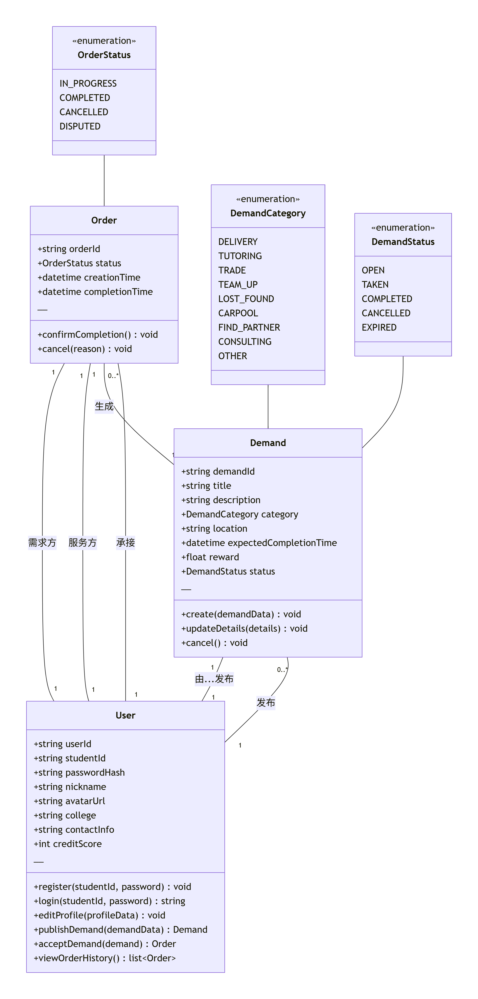
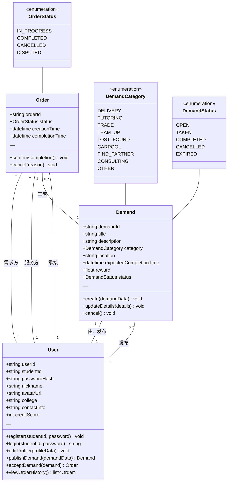

### 原始违规类图

> 以下为 AI 最初设计的类图（存在 S/I/D 违规）。下方的 Mermaid 描述已更新为**当前代码的实际数据模型**——通过引入三层架构（Controller → Service → Repository），所有违规已修复：User 回归纯数据实体，业务逻辑移至 Service 层。

**Mermaid 原始类图描述**

### SOLID原则审查清单

| SOLID原则 | 检查问题 | AI设计是否违反 | 违反说明 | 修正方案 |
| :--- | :---: | :--- | :--- | :--- |
| **S - 单一职责** | 有没有类承担了过多职责？ | **是** | `User` 类承担了三个不同维度的职责： 1. **身份与认证**（`register`, `login`, `passwordHash`）。 2. **个人资料管理**（`editProfile`, `nickname`, `avatarUrl`）。 3. **业务动作**（`publishDemand`, `acceptDemand`, `viewOrderHistory`），这些方法直接返回了`Demand`或`Order`，暗示了它可能参与了这些对象的创建逻辑，使其与“需求”和“订单”这两个领域紧密耦合。 | 1. **拆分职责**：将业务动作方法从`User`类中移出。 2. **引入Service层/Manager类**：创建一个或多个Service类（如`DemandService`, `OrderService`）来处理业务逻辑。例如，创建一个`DemandService.createDemand(userId, demandData)`方法，它接收一个用户ID和需求数据来创建一个`Demand`对象。`User`类回归其核心职责：管理用户自身的身份和数据。 |
| **O - 开闭原则** | 新增需求类型是否需要修改现有代码？ | **否** | `DemandCategory`被设计为枚举（`enum`）。当需要增加新的需求分类（如“代取作业”）时，只需在`DemandCategory`枚举中添加一个新的成员即可。这符合对扩展开放（增加新枚举成员）、对修改关闭（现有使用该枚举的代码逻辑无需改动）的原则。 | （无） |
| **L - 里氏替换** | 子类是否可以替换父类使用？ | **不适用** | 在当前P0的核心类图设计中，并未使用到继承关系。`User`, `Demand`, `Order` 都是独立的核心实体，它们之间是关联、聚合或组合关系，而非父子关系。因此，此原则目前不适用。 | （无） |
| **I - 接口隔离** | 有没有接口太“胖”，包含了不需要的方法？ | **是（轻微）** | `User`类的方法可以看作是它的“接口”。对于一个只需要显示用户信息（如在需求详情页显示发布者昵称和头像）的场景，调用者却能看到`login`, `register`, `publishDemand`等不相关的方法。虽然在类设计层面这不完全等同于接口隔离，但其精神是相通的：一个类暴露了超出某些客户端需求的过多行为。 | 1. **引入DTO (Data Transfer Object)**：创建一个`UserProfileDTO`类，只包含需要展示给其他用户的公共信息（如`userId`, `nickname`, `avatarUrl`, `creditScore`）。当需要展示用户信息时，返回这个DTO对象，而不是完整的`User`实体。这可以隐藏内部实现和不相关的方法，实现接口隔离。 |
| **D - 依赖倒转** | 高层模块是否直接依赖于低层模块的具体实现？ | **是** | 1. 在原始设计中，`User`类的方法如 `publishDemand()` 直接返回一个具体的`Demand`类实例。这暗示了`User`（高层模块）直接依赖于`Demand`（低层模块）的具体实现（`new Demand(...)`）。 2. 这种依赖关系使得如果`Demand`的创建过程变得复杂（例如需要验证、查数据库），`User`类就必须被修改。 | 1. **应用“单一职责”的修正方案**：引入Service层（`DemandService`, `OrderService`）作为抽象层。  2. **依赖于抽象而非具体**：`UserController`（更高层）调用`DemandService`。`DemandService`处理业务逻辑，并依赖于`DemandRepository`（更低层）进行数据持久化。这样，高层模块（Controller）依赖于中间层（Service），而不是直接依赖于低层实体（`Demand`）的创建细节。 |

---

### 总结记录

*   **AI原始设计中有多少处违反SOLID原则？**
    *   总计 **3** 处违反：
        1.  违反了 **单一职责原则 (S)**：`User`类职责过多。
        2.  违反了 **接口隔离原则 (I)**：`User`类暴露了不必要的行为细节。
        3.  违反了 **依赖倒转原则 (D)**：高层模块（`User`的业务方法）直接依赖于低层模块（`Demand`, `Order`）的具体创建。

*   **修正了哪些？**
    1.  **修正单一职责和依赖倒转**：通过将业务逻辑（如创建需求、接受订单）从`User`类中剥离，并构想一个独立的**Service层**来处理这些操作。这使得`User`类只负责管理用户数据，而Service层负责协调业务流程，高层模块（未来的Controller）将依赖于Service层，而不是直接依赖于`Demand`或`_Order`的实例化细节。
    2.  **修正接口隔离**：通过引入**DTO（数据传输对象）** 的概念，为不同的展示场景提供“瘦”接口，只暴露必要的数据字段，隐藏了`User`实体的内部方法和敏感信息，使客户端免于依赖它们不需要的功能。