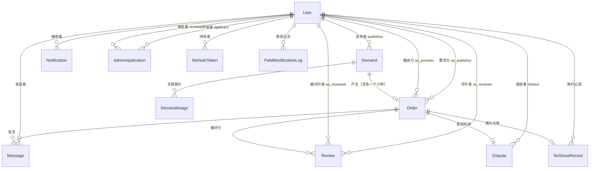
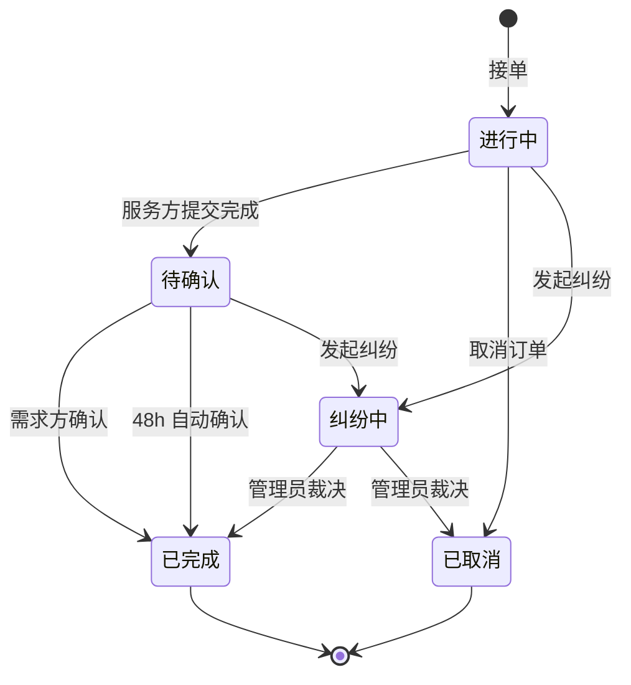

# 数据库设计 — ER 图

**CampusHub 校园互助服务平台**

| 版本 | 日期 | 作者 | 说明 |
| --- | --- | --- | --- |
| 1.0 | 2026-05-12 | AI 生成 | 基于 API 设计文档导出数据库 ER 图 |

---

## 1. ER 图（Mermaid）



---

## 2. 实体定义

### 2.1 User（用户）

核心用户表，存储用户账号信息和基本资料。

| 字段 | 类型 | 约束 | 说明 |
| --- | --- | --- | --- |
| `id` | INT | **PK**, AUTO_INCREMENT | 用户 ID |
| `student_id` | VARCHAR(10) | **UNIQUE**, NOT NULL | 学号（10 位数字） |
| `password_hash` | VARCHAR(255) | NOT NULL | 密码 bcrypt 哈希 |
| `nickname` | VARCHAR(20) | NOT NULL | 昵称（1-20 字） |
| `name` | VARCHAR(20) | | 真实姓名（选填） |
| `college` | VARCHAR(50) | | 学院 |
| `phone_encrypted` | VARBINARY(255) | | 手机号（AES-256-CBC 加密存储） |
| `email` | VARCHAR(100) | | 邮箱 |
| `avatar` | VARCHAR(500) | | 头像 URL |
| `credit_score` | INT | DEFAULT 70, CHECK(0-100) | 信用分 |
| `role` | ENUM('student','admin') | DEFAULT 'student' | 用户角色 |
| `show_real_name` | BOOLEAN | DEFAULT FALSE | 是否对外展示真实姓名 |
| `status` | ENUM('正常','已禁用') | DEFAULT '正常' | 账号状态 |
| `restricted_until` | DATETIME | | 限制发布截止时间 |
| `created_at` | DATETIME | NOT NULL | 注册时间 |
| `updated_at` | DATETIME | NOT NULL | 更新时间 |
| `last_login_at` | DATETIME | | 最后登录时间 |

> **索引**：`student_id`（唯一索引）、`nickname`（普通索引，支持搜索）

---

### 2.2 Demand（需求）

用户发布的互助需求。

| 字段 | 类型 | 约束 | 说明 |
| --- | --- | --- | --- |
| `id` | INT | **PK**, AUTO_INCREMENT | 需求 ID |
| `publisher_id` | INT | **FK → User.id**, NOT NULL | 发布者 ID |
| `title` | VARCHAR(100) | NOT NULL | 需求标题 |
| `description` | VARCHAR(2000) | NOT NULL | 详细描述 |
| `category` | ENUM('快递代取','学习辅导','二手交易','活动组队','失物招领','拼车拼单','找搭子','咨询答疑','其他') | NOT NULL | 需求分类 |
| `location` | VARCHAR(200) | | 地点 |
| `expected_time` | DATETIME | | 期望完成时间 |
| `reward` | DECIMAL(6,2) | DEFAULT 0, CHECK(>=0) | 报酬（0=无偿） |
| `status` | ENUM('开放','进行中','已完成','已关闭') | DEFAULT '开放', NOT NULL | 需求状态 |
| `is_urgent` | BOOLEAN | DEFAULT FALSE | 是否紧急（置顶展示） |
| `is_anonymous` | BOOLEAN | DEFAULT FALSE | 是否匿名发布 |
| `version` | INT | DEFAULT 1 | 乐观锁版本号 |
| `created_at` | DATETIME | NOT NULL | 发布时间 |
| `updated_at` | DATETIME | NOT NULL | 更新时间 |

> **索引**：`publisher_id`（FK 索引）、`category`（普通索引）、`status`（普通索引）、`created_at`（普通索引，支持排序）

---

### 2.3 Order（订单）

承接需求的订单，管理接单到完成的完整流程。

| 字段 | 类型 | 约束 | 说明 |
| --- | --- | --- | --- |
| `id` | INT | **PK**, AUTO_INCREMENT | 订单 ID |
| `demand_id` | INT | **FK → Demand.id**, NOT NULL, **UNIQUE** | 关联需求 ID |
| `publisher_id` | INT | **FK → User.id**, NOT NULL | 需求方（发布者）ID |
| `provider_id` | INT | **FK → User.id**, NOT NULL | 服务方（接单者）ID |
| `status` | ENUM('进行中','待确认','已完成','已取消','纠纷中') | NOT NULL | 订单状态 |
| `reward` | DECIMAL(6,2) | NOT NULL | 报酬金额（从需求继承） |
| `is_paid` | BOOLEAN | DEFAULT FALSE | 是否已付款/托管 |
| `version` | INT | DEFAULT 1 | 乐观锁版本号 |
| `message` | VARCHAR(500) | | 接单留言 |
| `cancelled_by` | VARCHAR(10) | | 取消方（publisher / provider） |
| `created_at` | DATETIME | NOT NULL | 创建时间 |
| `completed_at` | DATETIME | | 完成时间 |
| `cancelled_at` | DATETIME | | 取消时间 |
| `cancel_reason` | VARCHAR(500) | | 取消原因 |

> **索引**：`demand_id`（唯一索引，一个需求只能有一个订单）、`publisher_id`（FK 索引）、`provider_id`（FK 索引）、`status`（普通索引）

---

### 2.4 Review（评价）

订单完成后的双方互评。

| 字段 | 类型 | 约束 | 说明 |
| --- | --- | --- | --- |
| `id` | INT | **PK**, AUTO_INCREMENT | 评价 ID |
| `order_id` | INT | **FK → Order.id**, NOT NULL | 关联订单 ID |
| `from_user_id` | INT | **FK → User.id**, NOT NULL | 评价者 ID |
| `to_user_id` | INT | **FK → User.id**, NOT NULL | 被评价者 ID |
| `rating` | TINYINT | NOT NULL, CHECK(1-5) | 评分（1-5 星） |
| `content` | VARCHAR(1000) | | 文字评价内容 |
| `created_at` | DATETIME | NOT NULL | 评价时间 |

> **约束**：`UNIQUE(order_id, from_user_id)` — 每个订单每个用户只能评价一次
> **索引**：`order_id`（FK 索引）、`to_user_id`（FK 索引，按用户聚合评价列表）

---

### 2.5 Notification（通知）

系统自动生成的通知消息。

| 字段 | 类型 | 约束 | 说明 |
| --- | --- | --- | --- |
| `id` | INT | **PK**, AUTO_INCREMENT | 通知 ID |
| `user_id` | INT | **FK → User.id**, NOT NULL | 接收用户 ID |
| `type` | VARCHAR(50) | NOT NULL | 通知类型（order_taken / order_completed / order_confirmed / order_cancelled / review_received / dispute_update） |
| `title` | VARCHAR(200) | NOT NULL | 通知标题 |
| `content` | TEXT | NOT NULL | 通知内容 |
| `related_id` | INT | | 关联业务 ID（订单 ID / 需求 ID） |
| `is_read` | BOOLEAN | DEFAULT FALSE | 是否已读 |
| `created_at` | DATETIME | NOT NULL | 创建时间 |

> **索引**：`user_id`（FK 索引）、`is_read`（普通索引，筛选未读通知）、`created_at`（普通索引，按时间排序）

---

### 2.6 Message（聊天消息）

订单内的即时通讯消息（P2）。

| 字段 | 类型 | 约束 | 说明 |
| --- | --- | --- | --- |
| `id` | INT | **PK**, AUTO_INCREMENT | 消息 ID |
| `order_id` | INT | **FK → Order.id**, NOT NULL | 所属订单 ID |
| `sender_id` | INT | **FK → User.id**, NOT NULL | 发送者 ID |
| `content_type` | ENUM('text','image') | DEFAULT 'text', NOT NULL | 消息类型 |
| `content` | VARCHAR(2000) | NOT NULL | 消息内容（文字或图片 URL） |
| `created_at` | DATETIME | NOT NULL | 发送时间 |

> **索引**：`order_id`（FK 索引）、`(order_id, created_at)`（复合索引，按时间线获取聊天记录）

---

### 2.7 Dispute（纠纷）

订单纠纷申诉记录。

| 字段 | 类型 | 约束 | 说明 |
| --- | --- | --- | --- |
| `id` | INT | **PK**, AUTO_INCREMENT | 纠纷 ID |
| `order_id` | INT | **FK → Order.id**, NOT NULL, **UNIQUE** | 关联订单 ID |
| `initiator_id` | INT | **FK → User.id**, NOT NULL | 申诉发起人 ID |
| `reason` | VARCHAR(2000) | NOT NULL | 申诉理由 |
| `evidence` | JSON | | 证据图片 URL 数组 |
| `status` | ENUM('待处理','已处理') | DEFAULT '待处理', NOT NULL | 处理状态 |
| `resolution` | VARCHAR(2000) | | 管理员处理结果 |
| `created_at` | DATETIME | NOT NULL | 申诉时间 |
| `resolved_at` | DATETIME | | 处理时间 |

> **索引**：`order_id`（唯一索引，一个订单最多一个纠纷）、`status`（普通索引，筛选待处理纠纷）

---

### 2.8 AdminApplication（管理员申请）

学生申请成为志愿管理员的记录。

| 字段 | 类型 | 约束 | 说明 |
| --- | --- | --- | --- |
| `id` | INT | **PK**, AUTO_INCREMENT | 申请 ID |
| `user_id` | INT | **FK → User.id**, NOT NULL | 申请人 ID |
| `reason` | VARCHAR(2000) | NOT NULL | 申请理由 |
| `status` | ENUM('待审批','已通过','已拒绝') | DEFAULT '待审批', NOT NULL | 审批状态 |
| `reviewer_id` | INT | **FK → User.id** | 审批人 ID（管理员） |
| `review_comment` | VARCHAR(500) | | 审批意见 |
| `created_at` | DATETIME | NOT NULL | 申请时间 |
| `reviewed_at` | DATETIME | | 审批时间 |

> **索引**：`user_id`（唯一索引，每个用户只能提交一个申请）、`status`（普通索引，筛选待审批）

---

### 2.9 RefreshToken（刷新令牌）

用于 Token 轮换机制的刷新令牌存储。

| 字段 | 类型 | 约束 | 说明 |
| --- | --- | --- | --- |
| `id` | INT | **PK**, AUTO_INCREMENT | 记录 ID |
| `user_id` | INT | **FK → User.id**, NOT NULL | 用户 ID |
| `token_hash` | VARCHAR(255) | **UNIQUE**, NOT NULL | 刷新令牌的哈希值 |
| `expires_at` | DATETIME | NOT NULL | 过期时间（7 天） |
| `is_revoked` | BOOLEAN | DEFAULT FALSE | 是否已撤销 |
| `created_at` | DATETIME | NOT NULL | 创建时间 |

> **索引**：`token_hash`（唯一索引）、`user_id`（FK 索引）、`expires_at`（普通索引，清理过期记录）

---

### 2.10 DemandImage（需求图片）

需求关联的多张图片，通过独立的关系表存储（非 JSON 字段）。

| 字段 | 类型 | 约束 | 说明 |
| --- | --- | --- | --- |
| `id` | INT | **PK**, AUTO_INCREMENT | 图片 ID |
| `demand_id` | INT | **FK → Demand.id**, NOT NULL | 关联需求 ID |
| `url` | VARCHAR(500) | NOT NULL | 图片 URL |
| `sort_order` | TINYINT | DEFAULT 0 | 排序序号 |
| `created_at` | DATETIME | NOT NULL | 上传时间 |

> **索引**：`demand_id`（FK 索引）

---

### 2.11 NoShowRecord（爽约记录）

服务方取消订单（爽约）的审计记录。

| 字段 | 类型 | 约束 | 说明 |
| --- | --- | --- | --- |
| `id` | INT | **PK**, AUTO_INCREMENT | 记录 ID |
| `user_id` | INT | **FK → User.id**, NOT NULL | 爽约用户 ID |
| `order_id` | INT | **FK → Order.id**, UNIQUE, NOT NULL | 关联订单 ID |
| `created_at` | DATETIME | NOT NULL | 记录时间 |

> **索引**：`(user_id, created_at)`（复合索引，按用户聚合爽约记录）

---

### 2.12 FieldModificationLog（字段修改日志）

用户敏感字段（如手机号）修改的审计日志。

| 字段 | 类型 | 约束 | 说明 |
| --- | --- | --- | --- |
| `id` | INT | **PK**, AUTO_INCREMENT | 日志 ID |
| `user_id` | INT | **FK → User.id**, NOT NULL | 用户 ID |
| `field_name` | VARCHAR(20) | NOT NULL | 修改的字段名 |
| `old_value` | VARCHAR(255) | | 修改前值 |
| `new_value` | VARCHAR(255) | | 修改后值 |
| `modified_at` | DATETIME | NOT NULL | 修改时间 |

> **索引**：`(user_id, field_name, modified_at)`（复合索引，按用户+字段聚合日志）

---

## 3. 实体关系矩阵

| 实体 A | 关系 | 实体 B | 说明 |
| --- | --- | --- | --- |
| User | 1 ──── N | Demand | 一个用户可发布多个需求 |
| User | 1 ──── N | Order (publisher) | 一个用户可作为需求方拥有多个订单 |
| User | 1 ──── N | Order (provider) | 一个用户可作为服务方承接多个订单 |
| User | 1 ──── N | Review (from_user) | 一个用户可发出多个评价 |
| User | 1 ──── N | Review (to_user) | 一个用户可收到多个评价 |
| User | 1 ──── N | Notification | 一个用户可收到多条通知 |
| User | 1 ──── N | Message | 一个用户可发送多条消息 |
| User | 1 ──── N | Dispute | 一个用户可发起多个纠纷 |
| User | 1 ──── N | AdminApplication (applicant) | 一个用户可提交管理员申请 |
| User | 1 ──── N | AdminApplication (reviewer) | 一个管理员可审批多个申请 |
| User | 1 ──── N | RefreshToken | 一个用户可有多个刷新令牌 |
| User | 1 ──── N | NoShowRecord | 一个用户可有多次爽约记录 |
| User | 1 ──── N | FieldModificationLog | 一个用户可有多个字段修改日志 |
| Demand | 1 ──── 0..1 | Order | 一个需求最多对应一个有效订单（demandId 唯一） |
| Demand | 1 ──── N | DemandImage | 一个需求可有多张图片 |
| Order | 1 ──── N | Message | 一个订单内可有多条聊天消息 |
| Order | 1 ──── N | Review | 一个订单可收到最多 2 条评价（双方互评） |
| Order | 1 ──── 0..1 | Dispute | 一个订单最多发起 1 次纠纷 |
| Order | 1 ──── 0..1 | NoShowRecord | 一个订单最多关联 1 次爽约记录 |
| Order | N ──── 1 | Demand | 订单属于某一个需求 |

---

## 4. 订单状态机

**Mermaid 状态机图：**



**ASCII 示意：**

```
接单(post /orders)         提交完成(put /complete)       确认完成(put /confirm)
─────────→ [进行中] ──────────────────→ [待确认] ──────────────────→ [已完成]
             │                               │
             │ 取消(put /cancel)              │ 48h 未确认 → 自动确认
             └──────────→ [已取消]            └─────────────────────→ [已完成]
             │
             │ 纠纷(post /dispute)
             └──────────→ [纠纷中] ─── 管理员处理 ──→ [已完成] / [已取消]
```

---

## 5. 信用分自动更新规则

| 事件 | 信用分变化 | 说明 |
| --- | --- | --- |
| 收到 5 星评价 | +3 | 好评加分 |
| 收到 4 星评价 | +1 | 好评加分 |
| 收到 3 星评价 | 0 | 中性 |
| 收到 1-2 星评价 | -5 | 差评扣分 |
| 服务方取消订单（爽约） | -10 | 爽约扣分 |
| **初始分** | **70** | 注册即得 |
| **上限** | **100** | 超过不再增加 |

---

## 6. 关键约束总结

| 约束类型 | 说明 |
| --- | --- |
| 业务唯一性 | 一个需求同时只能有一个「开放」→「进行中」的订单（乐观锁 + 409） |
| 评价唯一性 | 每个订单每个用户只能评价一次 `UNIQUE(order_id, from_user_id)` |
| 纠纷唯一性 | 一个订单最多只能有一个纠纷 `UNIQUE(order_id)` |
| 申请唯一性 | 一个用户只能有一条管理员申请记录（`user_id` 唯一） |
| 学号唯一性 | `student_id` 全局唯一 |
| 学分范围 | `credit_score` 范围 0-100 |
| 评分范围 | `rating` 范围 1-5 |
| 密码要求 | 明文必须字母+数字组合，存储为 bcrypt 哈希 |
| 外键级联 | 用户禁用时保留其发布记录，不做物理删除 |
