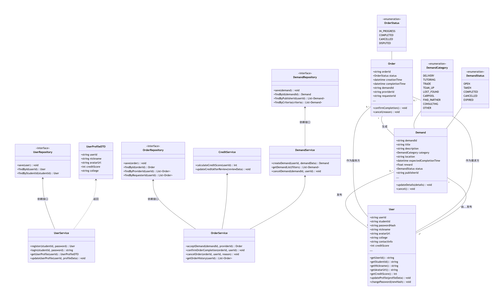
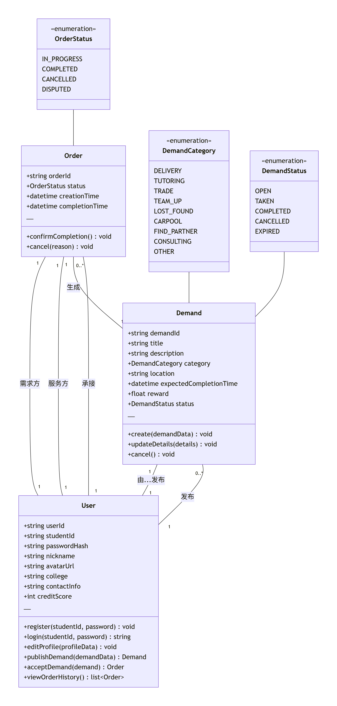
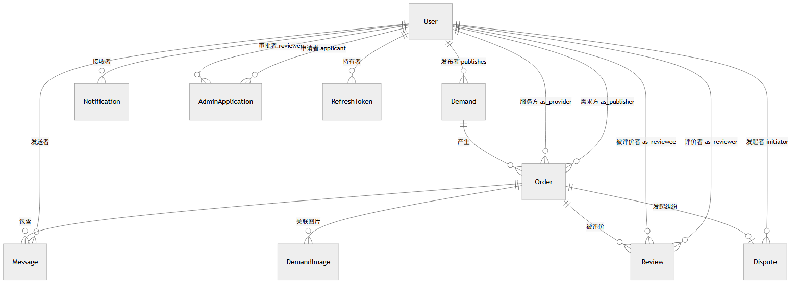
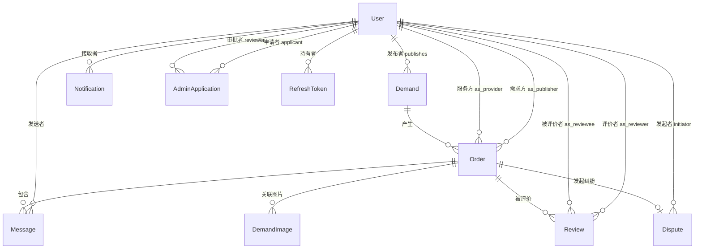

# 详细设计文档 — CampusHub 校园互助服务平台

| 版本 | 日期 | 作者 | 说明 |
| --- | --- | --- | --- |
| 1.0 | 2026-05-12 | CampusHub 团队 | 整合类图、API 设计、ER 图及建表语句的完整详细设计 |

---

## 目录

1. [文档概述](#1-文档概述)
2. [系统架构](#2-系统架构)
3. [类图设计](#3-类图设计)
4. [API 设计](#4-api-设计)
5. [数据库设计](#5-数据库设计)
6. [订单状态机](#6-订单状态机)
7. [信用分规则](#7-信用分规则)
8. [安全设计](#8-安全设计)
9. [需求追踪矩阵](#9-需求追踪矩阵)

---

## 1. 文档概述

### 1.1 项目背景

CampusHub 是一个面向在校大学生的校园互助服务平台。学生可以在平台上发布互助需求（如快递代取、学习辅导等），其他学生可以接单并提供帮助，平台通过评价和信用体系保障服务质量。

### 1.2 文档目的

本文档整合了 CampusHub 系统的详细设计成果，涵盖以下方面：

- **类图设计**：系统核心类的结构、属性和方法
- **API 设计**：全部 RESTful 接口定义
- **数据库设计**：ER 图、实体定义及建表语句

### 1.3 适用范围

本文档适用于 CampusHub 项目的开发人员、测试人员及项目管理人员，作为后续编码实现和系统测试的依据。

### 1.4 参考文档

| 文档名称 | 说明 |
| --- | --- |
| 需求规格说明书 | 来源于 Phase 1 |
| 架构设计文档 | 来源于 Phase 2 |
| SOLID 检查清单 | 类图设计的 SOLID 原则审查结果 |
| `api-spec.yaml` | 完整的 OpenAPI 3.0 规范文件 |

---

## 2. 系统架构

### 2.1 整体架构

CampusHub 采用前后端分离的三层架构：

```
┌─────────────────────────────────────────────────────┐
│                    客户端 (Web)                        │
├─────────────────────────────────────────────────────┤
│              API 网关层 (Nginx / Express)              │
├─────────────────────────────────────────────────────┤
│  认证模块 │ 用户模块 │ 需求模块 │ 订单模块 │ 评价模块  │
│  通知模块 │ 消息模块 │ 纠纷模块 │ 管理后台             │
├─────────────────────────────────────────────────────┤
│           MySQL 数据库 + Redis 缓存                    │
└─────────────────────────────────────────────────────┘
```

### 2.2 技术选型

| 层级 | 技术栈 |
| --- | --- |
| 前端 | Vue 3 / React + TypeScript |
| 后端 | Node.js + Express / NestJS |
| 数据库 | MySQL 8.0+ / MariaDB 10.5+ |
| ORM | Prisma |
| 认证 | JWT (Access Token + Refresh Token) |
| 缓存 | Redis（可选，用于会话和限流） |

### 2.3 模块划分与优先级

| 优先级 | 模块 | 说明 |
| --- | --- | --- |
| P0 | 认证模块 | 注册、登录、Token 刷新、登出 |
| P0 | 用户管理模块 | 个人信息获取与更新、公开资料查看 |
| P0 | 需求发布与浏览模块 | 发布、浏览、筛选、详情查看 |
| P0 | 订单流程管理模块 | 接单、状态流转、取消、纠纷 |
| P1 | 评价与信用模块 | 评价提交、信用分自动更新 |
| P1 | 通知模块 | 系统通知生成、通知列表 |
| P2 | 消息模块 | 订单内的即时聊天 |
| P2 | 推荐模块 | 需求推荐、匹配度排序 |
| P2 | 管理后台 | 用户/需求/纠纷/统计管理 |

---

## 3. 类图设计

### 3.1 核心类图



*图 1：CampusHub 系统核心类图（完整版）*

### 3.2 原始类图（含方法签名）



*图 2：原始类图（标注了各类的核心属性和方法签名）*

### 3.3 类描述

#### 3.3.1 User（用户）

核心用户类，存储用户账号信息和基本资料。

| 属性 | 类型 | 说明 |
| --- | --- | --- |
| id | Integer | 用户 ID（主键） |
| studentId | String | 学号（10 位数字，唯一） |
| passwordHash | String | 密码 bcrypt 哈希 |
| nickname | String | 昵称 |
| name | String? | 真实姓名 |
| college | String? | 学院 |
| phoneEncrypted | String? | 手机号（AES-256 加密存储） |
| email | String? | 邮箱 |
| avatar | String? | 头像 URL |
| creditScore | Integer | 信用分（0-100，初始 70） |
| role | Enum | student / admin |
| showRealName | Boolean | 是否对外展示真实姓名 |
| status | Enum | 正常 / 已禁用 |
| createdAt | DateTime | 注册时间 |
| updatedAt | DateTime | 更新时间 |
| lastLoginAt | DateTime? | 最后登录时间 |

**核心方法：**
- `canPublishDemand(): boolean` — 检查信用分是否 ≥ 40
- `getDisplayName(): string` — 根据 `showRealName` 返回昵称或真实姓名
- `updateCreditScore(delta: number): void` — 更新信用分（限制在 0-100 范围）

**关联关系：**
- 1:N → Demand（作为发布者）
- 1:N → Order（作为需求方 / 服务方）
- 1:N → Review（作为评价者 / 被评价者）
- 1:N → Notification（作为接收者）
- 1:N → Message（作为发送者）
- 1:N → Dispute（作为发起者）
- 1:N → AdminApplication（作为申请者 / 审批者）
- 1:N → RefreshToken（作为持有者）

#### 3.3.2 Demand（需求）

用户发布的互助需求。

| 属性 | 类型 | 说明 |
| --- | --- | --- |
| id | Integer | 需求 ID（主键） |
| publisherId | Integer | 发布者 ID（FK → User.id） |
| title | String | 标题 |
| description | String | 详细描述 |
| category | Enum | 快递代取 / 学习辅导 / 二手交易 / 活动组队 / 失物招领 / 拼车拼单 / 找搭子 / 咨询答疑 / 其他 |
| location | String? | 地点 |
| expectedTime | DateTime? | 期望完成时间 |
| reward | Decimal | 报酬（0=无偿） |
| status | Enum | 开放 / 进行中 / 已完成 / 已关闭 |
| isUrgent | Boolean | 是否紧急（置顶展示） |
| isAnonymous | Boolean | 是否匿名发布 |
| version | Integer | 乐观锁版本号 |
| createdAt | DateTime | 发布时间 |
| updatedAt | DateTime | 更新时间 |

**核心方法：**
- `canBeTaken(): boolean` — 检查是否处于「开放」状态
- `close(): void` — 关闭需求（状态变为「已关闭」）
- `markInProgress(): void` — 标记为「进行中」

**关联关系：**
- N:1 → User（发布者）
- 1:N → DemandImage（需求图片）
- 1:1…N → Order（一个需求对应一个订单）

#### 3.3.3 Order（订单）

承接需求的订单，管理从接单到完成的完整流程。

| 属性 | 类型 | 说明 |
| --- | --- | --- |
| id | Integer | 订单 ID（主键） |
| demandId | Integer | 关联需求 ID（FK → Demand.id，唯一） |
| publisherId | Integer | 需求方 ID |
| providerId | Integer | 服务方 ID |
| status | Enum | 进行中 / 待确认 / 已完成 / 已取消 / 纠纷中 |
| reward | Decimal | 报酬金额 |
| isPaid | Boolean | 是否已付款 |
| version | Integer | 乐观锁版本号 |
| message | String? | 接单留言 |
| createdAt | DateTime | 创建时间 |
| completedAt | DateTime? | 完成时间 |
| cancelledAt | DateTime? | 取消时间 |
| cancelReason | String? | 取消原因 |

**核心方法：**
- `confirmComplete(): void` — 需求方确认完成
- `submitComplete(): void` — 服务方提交完成
- `cancel(reason: string, cancelBy: UserRole): void` — 取消订单
- `initiateDispute(reason: string): Dispute` — 发起纠纷
- `autoConfirm(): void` — 48 小时自动确认

**关联关系：**
- N:1 → Demand
- N:1 → User（作为需求方 / 服务方）
- 1:N → Message
- 1:N → Review
- 1:0..1 → Dispute

#### 3.3.4 Review（评价）

订单完成后的双方互评。

| 属性 | 类型 | 说明 |
| --- | --- | --- |
| id | Integer | 评价 ID（主键） |
| orderId | Integer | 关联订单 ID |
| fromUserId | Integer | 评价者 ID |
| toUserId | Integer | 被评价者 ID |
| rating | Integer | 评分（1-5 星） |
| content | String? | 文字评价 |
| createdAt | DateTime | 评价时间 |

**核心方法：**
- `calculateCreditDelta(): number` — 计算信用分变化值（根据评分）

#### 3.3.5 Notification（通知）

系统自动生成的通知消息。

| 属性 | 类型 | 说明 |
| --- | --- | --- |
| id | Integer | 通知 ID（主键） |
| userId | Integer | 接收用户 ID |
| type | Enum | order_taken / order_completed / order_confirmed / order_cancelled / review_received / dispute_update |
| title | String | 通知标题 |
| content | Text | 通知内容 |
| relatedId | Integer? | 关联业务 ID |
| isRead | Boolean | 是否已读 |
| createdAt | DateTime | 创建时间 |

#### 3.3.6 Message（聊天消息）

订单内的即时通讯消息（P2）。

| 属性 | 类型 | 说明 |
| --- | --- | --- |
| id | Integer | 消息 ID（主键） |
| orderId | Integer | 所属订单 ID |
| senderId | Integer | 发送者 ID |
| contentType | Enum | text / image |
| content | String | 消息内容 |
| createdAt | DateTime | 发送时间 |

#### 3.3.7 Dispute（纠纷）

订单纠纷申诉记录。

| 属性 | 类型 | 说明 |
| --- | --- | --- |
| id | Integer | 纠纷 ID（主键） |
| orderId | Integer | 关联订单 ID（唯一） |
| initiatorId | Integer | 申诉发起人 ID |
| reason | String | 申诉理由 |
| evidence | JSON? | 证据图片 URL 数组 |
| status | Enum | 待处理 / 已处理 |
| resolution | String? | 管理员处理结果 |
| createdAt | DateTime | 申诉时间 |
| resolvedAt | DateTime? | 处理时间 |

#### 3.3.8 AdminApplication（管理员申请）

学生申请成为志愿管理员的记录。

| 属性 | 类型 | 说明 |
| --- | --- | --- |
| id | Integer | 申请 ID（主键） |
| userId | Integer | 申请人 ID（唯一） |
| reason | String | 申请理由 |
| status | Enum | 待审批 / 已通过 / 已拒绝 |
| reviewerId | Integer? | 审批人 ID |
| reviewComment | String? | 审批意见 |
| createdAt | DateTime | 申请时间 |
| reviewedAt | DateTime? | 审批时间 |

#### 3.3.9 RefreshToken（刷新令牌）

用于 Token 轮换机制的刷新令牌存储。

| 属性 | 类型 | 说明 |
| --- | --- | --- |
| id | Integer | 记录 ID（主键） |
| userId | Integer | 用户 ID |
| tokenHash | String | 刷新令牌的 SHA-256 哈希 |
| expiresAt | DateTime | 过期时间（7 天） |
| isRevoked | Boolean | 是否已撤销 |
| createdAt | DateTime | 创建时间 |

#### 3.3.10 DemandImage（需求图片）

需求关联的多张图片。

| 属性 | 类型 | 说明 |
| --- | --- | --- |
| id | Integer | 图片 ID（主键） |
| demandId | Integer | 关联需求 ID |
| url | String | 图片 URL |
| sortOrder | Integer | 排序序号 |
| createdAt | DateTime | 上传时间 |

### 3.4 类关系总览

```
User 1──N Demand (发布者)
User 1──N Order (作为需求方)
User 1──N Order (作为服务方)
User 1──N Review (作为评价者)
User 1──N Review (被评价者)
User 1──N Notification
User 1──N Message
User 1──N Dispute
User 1──N AdminApplication (申请者)
User 1──N AdminApplication (审批者)
User 1──N RefreshToken

Demand 1──N Order
Demand 1──N DemandImage

Order 1──N Message
Order 1──N Review
Order 1──0..1 Dispute
```

### 3.5 SOLID 原则检查

> 完整的 SOLID 检查清单见 [`SOLID 检查清单.md`](./SOLID%20检查清单.md) 及对应的 [`SOLID 检查清单.pdf`](./SOLID%20检查清单.pdf)。

| 原则 | 检查结果 | 说明 |
| --- | --- | --- |
| **S** 单一职责 | 通过 | 每个类聚焦单一业务实体，User 负责用户、Demand 负责需求、Order 负责订单，职责划分清晰 |
| **O** 开闭原则 | 通过 | 核心实体通过枚举和配置化参数支持扩展，新增需求分类或订单状态无需修改核心类结构 |
| **L** 里氏替换 | N/A | 当前设计未使用继承体系，不存在违反 LSP 的风险 |
| **I** 接口隔离 | 通过 | 各模块通过 Service 层接口交互，接口粒度按业务模块划分 |
| **D** 依赖反转 | 通过 | 高层模块依赖抽象接口（Service/Repository），不依赖具体实现 |

---

## 4. API 设计

### 4.1 基础信息

- **Base URL**：`http://localhost:3000/api`（开发）/ `https://api.campushub.example.com/api`（生产）
- **协议**：HTTPS/RESTful
- **数据格式**：请求/响应均为 JSON（文件上传除外）
- **认证方式**：JWT Bearer Token（`Authorization: Bearer <token>`）

### 4.2 通用响应格式

**成功响应：**
```json
{
  "code": 200,
  "message": "操作成功",
  "data": { ... }
}
```

**失败响应：**
```json
{
  "code": 400,
  "message": "错误描述",
  "errors": [
    { "field": "password", "message": "密码长度至少 8 位" }
  ],
  "timestamp": "2026-05-12T10:00:00Z"
}
```

### 4.3 错误码定义

| 错误码 | 说明 | 典型场景 |
| --- | --- | --- |
| 200 | 请求成功 | — |
| 201 | 创建成功 | 注册、发布需求、接单成功 |
| 400 | 请求参数错误 | 缺少必填字段、格式不正确 |
| 401 | 认证失败 | Token 缺失、过期或无效 |
| 403 | 权限不足 | 普通用户访问管理员接口、信用分 < 40 发布需求 |
| 404 | 资源不存在 | 用户/需求/订单不存在 |
| 409 | 资源冲突 | 学号已注册、抢单冲突、重复评价 |
| 413 | 上传文件过大 | 文件超过 10MB |
| 422 | 业务规则校验失败 | 信用分不足、爽约频率超标 |
| 429 | 请求过于频繁 | 触发接口限流 |
| 500 | 服务器内部错误 | 未预期异常 |

### 4.4 认证模块（P0）

#### 4.4.1 用户注册

`POST /api/auth/register`

| 字段 | 类型 | 必填 | 说明 |
| --- | --- | --- | --- |
| `studentId` | string | **是** | 学号（10 位数字） |
| `password` | string | **是** | 密码（8-32 位，字母+数字） |
| `nickname` | string | **是** | 昵称（1-20 字） |
| `name` | string | 否 | 真实姓名 |
| `email` | string | 否 | 邮箱 |
| `avatar` | string | 否 | 头像 URL |

**成功响应（201）：** 返回用户基本信息（id, studentId, nickname, creditScore, role, createdAt）

**错误场景：** 400（参数校验失败）、409（学号已注册）、429（IP 限流）

#### 4.4.2 用户登录

`POST /api/auth/login`

| 字段 | 类型 | 必填 | 说明 |
| --- | --- | --- | --- |
| `studentId` | string | **是** | 学号 |
| `password` | string | **是** | 密码 |

**成功响应（200）：** 返回 token, refreshToken, expiresIn, user 信息

**错误场景：** 400（参数校验失败）、401（学号或密码错误）、429（20 次/分钟限流）

#### 4.4.3 Token 刷新

`POST /api/auth/refresh`

| 字段 | 类型 | 必填 | 说明 |
| --- | --- | --- | --- |
| `refreshToken` | string | **是** | 登录时获取的 refresh_token |

**成功响应（200）：** 返回新的 token, refreshToken, expiresIn

> **轮换策略**：每次刷新返回新的 Token 对，旧的 refresh_token 立即失效。Access Token 有效期 3600s，Refresh Token 有效期 7 天。

#### 4.4.4 登出

`POST /api/auth/logout`

| 字段 | 类型 | 说明 |
| --- | --- | --- |
| `refreshToken` | string | 传入可使服务端标记该 token 失效 |

**成功响应（200）：** `{"code": 200, "message": "登出成功"}`

### 4.5 用户管理模块（P0）

| 接口 | 方法 | 认证 | 说明 |
| --- | --- | --- | --- |
| `/api/users/me` | GET | JWT | 获取个人信息 |
| `/api/users/me` | PUT | JWT | 更新个人信息（nickname, avatar, college, phone, showRealName） |
| `/api/users/{userId}/profile` | GET | JWT | 查看用户公开资料（信用分、评价统计） |

### 4.6 需求发布与浏览模块（P0）

| 接口 | 方法 | 认证 | 说明 |
| --- | --- | --- | --- |
| `/api/demands` | POST | JWT | 发布需求 |
| `/api/demands` | GET | 无需 | 浏览需求列表（含筛选、分页、排序） |
| `/api/demands/{demandId}` | GET | 无需 | 获取需求详情 |
| `/api/demands/{demandId}` | PUT | JWT | 更新需求（仅发布者） |
| `/api/demands/{demandId}` | DELETE | JWT | 删除需求 |

**需求列表查询参数：** category, status, keyword, sortBy, isUrgent, page, pageSize

### 4.7 订单流程管理模块（P0）

| 接口 | 方法 | 认证 | 说明 |
| --- | --- | --- | --- |
| `/api/orders` | POST | JWT | 接单（含乐观锁防并发抢单） |
| `/api/orders` | GET | JWT | 查看订单列表（按角色/状态筛选） |
| `/api/orders/{orderId}` | GET | JWT | 查看订单详情 |
| `/api/orders/{orderId}/complete` | PUT | JWT | 服务方提交完成 |
| `/api/orders/{orderId}/confirm` | PUT | JWT | 需求方确认完成 |
| `/api/orders/{orderId}/cancel` | PUT | JWT | 取消订单 |
| `/api/orders/{orderId}/dispute` | POST | JWT | 发起纠纷申诉 |

### 4.8 评价与信用模块（P1）

| 接口 | 方法 | 认证 | 说明 |
| --- | --- | --- | --- |
| `/api/reviews` | POST | JWT | 提交评价（每个订单每用户一次） |
| `/api/users/{userId}/reviews` | GET | JWT | 获取用户评价列表（分页） |

### 4.9 补充接口（P1 / P2）

| 接口 | 方法 | 优先级 | 说明 |
| --- | --- | --- | --- |
| `/api/notifications` | GET | P1 | 获取通知列表 |
| `/api/notifications/{id}` | PATCH | P1 | 标记通知已读 |
| `/api/messages` | GET | P2 | 获取聊天记录（按 orderId） |
| `/api/messages` | POST | P2 | 发送聊天消息 |
| `/api/recommendations/demands` | GET | P2 | 获取推荐需求 |
| `/api/upload` | POST | P0 | 文件上传（头像/图片） |
| `/api/admin/users` | GET | P2 | 管理员查看用户列表 |
| `/api/admin/users/{id}/status` | PUT | P2 | 管理员禁用/启用用户 |
| `/api/admin/demands` | GET | P2 | 管理员查看需求列表 |
| `/api/admin/demands/{id}` | DELETE | P2 | 管理员删除违规需求 |
| `/api/admin/statistics` | GET | P2 | 管理员查看统计看板 |
| `/api/admin/disputes` | GET | P2 | 管理员查看纠纷列表 |
| `/api/admin/disputes/{id}/resolve` | PUT | P2 | 管理员处理纠纷 |
| `/api/admin/applications` | GET | P2 | 管理员查看申请列表 |
| `/api/admin/applications/{id}/review` | PUT | P2 | 审批管理员申请 |

> 完整的 OpenAPI 3.0 规范见 [`api-spec.yaml`](./api-spec.yaml)。

---

## 5. 数据库设计

### 5.1 ER 图



*图 3：CampusHub 数据库 ER 图*

### 5.2 ER 图（Mermaid 描述）



### 5.3 实体定义

#### 5.3.1 User（用户）

| 字段 | 类型 | 约束 | 说明 |
| --- | --- | --- | --- |
| `id` | INT | PK, AUTO_INCREMENT | 用户 ID |
| `student_id` | VARCHAR(10) | UNIQUE, NOT NULL | 学号（10 位数字） |
| `password_hash` | VARCHAR(255) | NOT NULL | 密码 bcrypt 哈希 |
| `nickname` | VARCHAR(20) | NOT NULL | 昵称（1-20 字） |
| `name` | VARCHAR(20) | | 真实姓名（选填） |
| `college` | VARCHAR(50) | | 学院 |
| `phone_encrypted` | VARBINARY(255) | | 手机号 AES-256 加密存储 |
| `email` | VARCHAR(100) | | 邮箱 |
| `avatar` | VARCHAR(500) | | 头像 URL |
| `credit_score` | INT | DEFAULT 70, CHECK(0-100) | 信用分 |
| `role` | ENUM('student','admin') | DEFAULT 'student' | 用户角色 |
| `show_real_name` | BOOLEAN | DEFAULT FALSE | 是否对外展示真实姓名 |
| `status` | ENUM('正常','已禁用') | DEFAULT '正常' | 账号状态 |
| `created_at` | DATETIME | NOT NULL | 注册时间 |
| `updated_at` | DATETIME | NOT NULL | 更新时间 |
| `last_login_at` | DATETIME | | 最后登录时间 |

**索引：** `uk_student_id`（唯一索引）、`idx_nickname`（普通索引）

#### 5.3.2 Demand（需求）

| 字段 | 类型 | 约束 | 说明 |
| --- | --- | --- | --- |
| `id` | INT | PK, AUTO_INCREMENT | 需求 ID |
| `publisher_id` | INT | FK → User.id, NOT NULL | 发布者 ID |
| `title` | VARCHAR(100) | NOT NULL | 需求标题 |
| `description` | VARCHAR(2000) | NOT NULL | 详细描述 |
| `category` | ENUM | NOT NULL | 需求分类（9 种） |
| `location` | VARCHAR(200) | | 地点 |
| `expected_time` | DATETIME | | 期望完成时间 |
| `reward` | DECIMAL(6,2) | DEFAULT 0, CHECK(>=0) | 报酬 |
| `status` | ENUM | DEFAULT '开放' | 需求状态 |
| `is_urgent` | BOOLEAN | DEFAULT FALSE | 是否紧急 |
| `is_anonymous` | BOOLEAN | DEFAULT FALSE | 是否匿名 |
| `version` | INT | DEFAULT 1 | 乐观锁版本号 |
| `created_at` | DATETIME | NOT NULL | 发布时间 |
| `updated_at` | DATETIME | NOT NULL | 更新时间 |

**索引：** `idx_publisher_id`、`idx_category`、`idx_status_created`（复合）、`idx_status_category_created`（复合）、`ft_title_description`（全文索引）

#### 5.3.3 DemandImage（需求图片）

| 字段 | 类型 | 约束 | 说明 |
| --- | --- | --- | --- |
| `id` | INT | PK, AUTO_INCREMENT | 图片 ID |
| `demand_id` | INT | FK → Demand.id, NOT NULL | 关联需求 ID |
| `url` | VARCHAR(500) | NOT NULL | 图片 URL |
| `sort_order` | TINYINT | DEFAULT 0 | 排序序号 |
| `created_at` | DATETIME | NOT NULL | 上传时间 |

**索引：** `idx_demand_id`

#### 5.3.4 Order（订单）

| 字段 | 类型 | 约束 | 说明 |
| --- | --- | --- | --- |
| `id` | INT | PK, AUTO_INCREMENT | 订单 ID |
| `demand_id` | INT | FK → Demand.id, NOT NULL, UNIQUE | 关联需求 ID |
| `publisher_id` | INT | FK → User.id, NOT NULL | 需求方 ID |
| `provider_id` | INT | FK → User.id, NOT NULL | 服务方 ID |
| `status` | ENUM | NOT NULL | 订单状态（5 种） |
| `reward` | DECIMAL(6,2) | NOT NULL | 报酬金额 |
| `is_paid` | BOOLEAN | DEFAULT FALSE | 是否已付款 |
| `version` | INT | DEFAULT 1 | 乐观锁版本号 |
| `created_at` | DATETIME | NOT NULL | 创建时间 |
| `completed_at` | DATETIME | | 完成时间 |
| `cancelled_at` | DATETIME | | 取消时间 |
| `cancel_reason` | VARCHAR(500) | | 取消原因 |

**索引：** `uk_demand_id`（唯一）、`idx_publisher_status_created`（复合）、`idx_provider_status_created`（复合）、`idx_status`

#### 5.3.5 Review（评价）

| 字段 | 类型 | 约束 | 说明 |
| --- | --- | --- | --- |
| `id` | INT | PK, AUTO_INCREMENT | 评价 ID |
| `order_id` | INT | FK → Order.id, NOT NULL | 关联订单 ID |
| `from_user_id` | INT | FK → User.id, NOT NULL | 评价者 ID |
| `to_user_id` | INT | FK → User.id, NOT NULL | 被评价者 ID |
| `rating` | TINYINT | NOT NULL, CHECK(1-5) | 评分 |
| `content` | VARCHAR(1000) | | 评价内容 |
| `created_at` | DATETIME | NOT NULL | 评价时间 |

**约束：** `UNIQUE(order_id, from_user_id)` - 每个订单每用户只能评价一次
**索引：** `uk_order_from_user`（唯一）、`idx_to_user_id`

#### 5.3.6 Notification（通知）

| 字段 | 类型 | 约束 | 说明 |
| --- | --- | --- | --- |
| `id` | INT | PK, AUTO_INCREMENT | 通知 ID |
| `user_id` | INT | FK → User.id, NOT NULL | 接收用户 ID |
| `type` | ENUM | NOT NULL | 通知类型（6 种） |
| `title` | VARCHAR(200) | NOT NULL | 通知标题 |
| `content` | TEXT | NOT NULL | 通知内容 |
| `related_id` | INT | | 关联业务 ID |
| `is_read` | BOOLEAN | DEFAULT FALSE | 是否已读 |
| `created_at` | DATETIME | NOT NULL | 创建时间 |

**索引：** `idx_user_read_created`（复合索引）

#### 5.3.7 Message（聊天消息）

| 字段 | 类型 | 约束 | 说明 |
| --- | --- | --- | --- |
| `id` | INT | PK, AUTO_INCREMENT | 消息 ID |
| `order_id` | INT | FK → Order.id, NOT NULL | 所属订单 ID |
| `sender_id` | INT | FK → User.id, NOT NULL | 发送者 ID |
| `content_type` | ENUM('text','image') | DEFAULT 'text', NOT NULL | 消息类型 |
| `content` | VARCHAR(2000) | NOT NULL | 消息内容 |
| `created_at` | DATETIME | NOT NULL | 发送时间 |

**索引：** `idx_order_created`（复合索引）

#### 5.3.8 Dispute（纠纷）

| 字段 | 类型 | 约束 | 说明 |
| --- | --- | --- | --- |
| `id` | INT | PK, AUTO_INCREMENT | 纠纷 ID |
| `order_id` | INT | FK → Order.id, NOT NULL, UNIQUE | 关联订单 ID |
| `initiator_id` | INT | FK → User.id, NOT NULL | 申诉发起人 ID |
| `reason` | VARCHAR(2000) | NOT NULL | 申诉理由 |
| `evidence` | JSON | | 证据图片 URL 数组 |
| `status` | ENUM | DEFAULT '待处理', NOT NULL | 处理状态 |
| `resolution` | VARCHAR(2000) | | 处理结果 |
| `created_at` | DATETIME | NOT NULL | 申诉时间 |
| `resolved_at` | DATETIME | | 处理时间 |

**索引：** `uk_order_id`（唯一）、`idx_status`

#### 5.3.9 AdminApplication（管理员申请）

| 字段 | 类型 | 约束 | 说明 |
| --- | --- | --- | --- |
| `id` | INT | PK, AUTO_INCREMENT | 申请 ID |
| `user_id` | INT | FK → User.id, NOT NULL, UNIQUE | 申请人 ID |
| `reason` | VARCHAR(2000) | NOT NULL | 申请理由 |
| `status` | ENUM | DEFAULT '待审批', NOT NULL | 审批状态 |
| `reviewer_id` | INT | FK → User.id | 审批人 ID |
| `review_comment` | VARCHAR(500) | | 审批意见 |
| `created_at` | DATETIME | NOT NULL | 申请时间 |
| `reviewed_at` | DATETIME | | 审批时间 |

**索引：** `uk_user_id`（唯一）、`idx_status`

#### 5.3.10 RefreshToken（刷新令牌）

| 字段 | 类型 | 约束 | 说明 |
| --- | --- | --- | --- |
| `id` | INT | PK, AUTO_INCREMENT | 记录 ID |
| `user_id` | INT | FK → User.id, NOT NULL | 用户 ID |
| `token_hash` | VARCHAR(255) | UNIQUE, NOT NULL | 令牌哈希 |
| `expires_at` | DATETIME | NOT NULL | 过期时间（7 天） |
| `is_revoked` | BOOLEAN | DEFAULT FALSE | 是否已撤销 |
| `created_at` | DATETIME | NOT NULL | 创建时间 |

**索引：** `uk_token_hash`（唯一）、`idx_user_id`、`idx_expires_at`

### 5.4 建表语句

完整的建表语句如下（基于 MySQL 8.0+ / MariaDB 10.5+，字符集 `utf8mb4`）：

```sql
-- ============================================================
-- 1. User（用户）
-- ============================================================
CREATE TABLE `User` (
    `id`              INT             NOT NULL AUTO_INCREMENT  COMMENT '用户 ID',
    `student_id`      VARCHAR(10)     NOT NULL                COMMENT '学号（10 位数字，唯一）',
    `password_hash`   VARCHAR(255)    NOT NULL                COMMENT '密码 bcrypt 哈希',
    `nickname`        VARCHAR(20)     NOT NULL                COMMENT '昵称（1-20 字）',
    `name`            VARCHAR(20)     DEFAULT NULL            COMMENT '真实姓名（选填）',
    `college`         VARCHAR(50)     DEFAULT NULL            COMMENT '学院',
    `phone_encrypted` VARBINARY(255)  DEFAULT NULL            COMMENT '手机号 AES-256 加密存储',
    `email`           VARCHAR(100)    DEFAULT NULL            COMMENT '邮箱',
    `avatar`          VARCHAR(500)    DEFAULT NULL            COMMENT '头像 URL',
    `credit_score`    INT             NOT NULL DEFAULT 70     COMMENT '信用分（0-100，初始 70）',
    `role`            ENUM('student', 'admin') NOT NULL DEFAULT 'student' COMMENT '用户角色',
    `show_real_name`  TINYINT(1)      NOT NULL DEFAULT 0      COMMENT '是否对外展示真实姓名',
    `status`          ENUM('正常', '已禁用') NOT NULL DEFAULT '正常' COMMENT '账号状态',
    `created_at`      DATETIME        NOT NULL                COMMENT '注册时间',
    `updated_at`      DATETIME        NOT NULL                COMMENT '更新时间',
    `last_login_at`   DATETIME        DEFAULT NULL            COMMENT '最后登录时间',

    PRIMARY KEY (`id`),
    UNIQUE KEY `uk_student_id` (`student_id`),
    KEY `idx_nickname` (`nickname`)
) ENGINE=InnoDB DEFAULT CHARSET=utf8mb4 COLLATE=utf8mb4_unicode_ci COMMENT='用户表';
```

```sql
-- ============================================================
-- 2. Demand（需求）
-- ============================================================
CREATE TABLE `Demand` (
    `id`              INT             NOT NULL AUTO_INCREMENT  COMMENT '需求 ID',
    `publisher_id`    INT             NOT NULL                COMMENT '发布者 ID（FK → User.id）',
    `title`           VARCHAR(100)    NOT NULL                COMMENT '需求标题',
    `description`     VARCHAR(2000)   NOT NULL                COMMENT '详细描述',
    `category`        ENUM('快递代取','学习辅导','二手交易','活动组队',
                           '失物招领','拼车拼单','找搭子','咨询答疑','其他')
                                        NOT NULL                COMMENT '需求分类',
    `location`        VARCHAR(200)    DEFAULT NULL            COMMENT '地点',
    `expected_time`   DATETIME        DEFAULT NULL            COMMENT '期望完成时间',
    `reward`          DECIMAL(6,2)    NOT NULL DEFAULT 0.00   COMMENT '报酬（0=无偿）',
    `status`          ENUM('开放','进行中','已完成','已关闭')
                                        NOT NULL DEFAULT '开放' COMMENT '需求状态',
    `is_urgent`       TINYINT(1)      NOT NULL DEFAULT 0      COMMENT '是否紧急（置顶展示）',
    `is_anonymous`    TINYINT(1)      NOT NULL DEFAULT 0      COMMENT '是否匿名发布',
    `version`         INT             NOT NULL DEFAULT 1      COMMENT '乐观锁版本号',
    `created_at`      DATETIME        NOT NULL                COMMENT '发布时间',
    `updated_at`      DATETIME        NOT NULL                COMMENT '更新时间',

    PRIMARY KEY (`id`),
    KEY `idx_publisher_id` (`publisher_id`),
    KEY `idx_category` (`category`),
    KEY `idx_status_created` (`status`, `created_at`),
    KEY `idx_status_category_created` (`status`, `category`, `created_at`),
    FULLTEXT KEY `ft_title_description` (`title`, `description`),
    CONSTRAINT `fk_demand_publisher` FOREIGN KEY (`publisher_id`)
        REFERENCES `User` (`id`)
) ENGINE=InnoDB DEFAULT CHARSET=utf8mb4 COLLATE=utf8mb4_unicode_ci COMMENT='需求表';
```

```sql
-- ============================================================
-- 3. DemandImage（需求图片）
-- ============================================================
CREATE TABLE `DemandImage` (
    `id`              INT             NOT NULL AUTO_INCREMENT  COMMENT '图片 ID',
    `demand_id`       INT             NOT NULL                COMMENT '关联需求 ID（FK → Demand.id）',
    `url`             VARCHAR(500)    NOT NULL                COMMENT '图片 URL',
    `sort_order`      TINYINT         NOT NULL DEFAULT 0      COMMENT '排序序号',
    `created_at`      DATETIME        NOT NULL                COMMENT '上传时间',

    PRIMARY KEY (`id`),
    KEY `idx_demand_id` (`demand_id`),
    CONSTRAINT `fk_demand_image_demand` FOREIGN KEY (`demand_id`)
        REFERENCES `Demand` (`id`) ON DELETE CASCADE
) ENGINE=InnoDB DEFAULT CHARSET=utf8mb4 COLLATE=utf8mb4_unicode_ci COMMENT='需求图片表';
```

```sql
-- ============================================================
-- 4. Order（订单）
-- ============================================================
CREATE TABLE `Order` (
    `id`              INT             NOT NULL AUTO_INCREMENT  COMMENT '订单 ID',
    `demand_id`       INT             NOT NULL                COMMENT '关联需求 ID（FK → Demand.id，唯一）',
    `publisher_id`    INT             NOT NULL                COMMENT '需求方 ID（FK → User.id）',
    `provider_id`     INT             NOT NULL                COMMENT '服务方 ID（FK → User.id）',
    `status`          ENUM('进行中','待确认','已完成','已取消','纠纷中')
                                        NOT NULL                COMMENT '订单状态',
    `reward`          DECIMAL(6,2)    NOT NULL                COMMENT '报酬金额（从需求继承）',
    `is_paid`         TINYINT(1)      NOT NULL DEFAULT 0      COMMENT '是否已付款',
    `version`         INT             NOT NULL DEFAULT 1      COMMENT '乐观锁版本号',
    `created_at`      DATETIME        NOT NULL                COMMENT '创建时间',
    `completed_at`    DATETIME        DEFAULT NULL            COMMENT '完成时间',
    `cancelled_at`    DATETIME        DEFAULT NULL            COMMENT '取消时间',
    `cancel_reason`   VARCHAR(500)    DEFAULT NULL            COMMENT '取消原因',

    PRIMARY KEY (`id`),
    UNIQUE KEY `uk_demand_id` (`demand_id`),
    KEY `idx_publisher_status_created` (`publisher_id`, `status`, `created_at`),
    KEY `idx_provider_status_created` (`provider_id`, `status`, `created_at`),
    KEY `idx_status` (`status`),
    CONSTRAINT `fk_order_demand` FOREIGN KEY (`demand_id`)
        REFERENCES `Demand` (`id`),
    CONSTRAINT `fk_order_publisher` FOREIGN KEY (`publisher_id`)
        REFERENCES `User` (`id`),
    CONSTRAINT `fk_order_provider` FOREIGN KEY (`provider_id`)
        REFERENCES `User` (`id`)
) ENGINE=InnoDB DEFAULT CHARSET=utf8mb4 COLLATE=utf8mb4_unicode_ci COMMENT='订单表';
```

```sql
-- ============================================================
-- 5. Review（评价）
-- ============================================================
CREATE TABLE `Review` (
    `id`              INT             NOT NULL AUTO_INCREMENT  COMMENT '评价 ID',
    `order_id`        INT             NOT NULL                COMMENT '关联订单 ID（FK → Order.id）',
    `from_user_id`    INT             NOT NULL                COMMENT '评价者 ID（FK → User.id）',
    `to_user_id`      INT             NOT NULL                COMMENT '被评价者 ID（FK → User.id）',
    `rating`          TINYINT         NOT NULL                COMMENT '评分（1-5 星）',
    `content`         VARCHAR(1000)   DEFAULT NULL            COMMENT '文字评价内容',
    `created_at`      DATETIME        NOT NULL                COMMENT '评价时间',

    PRIMARY KEY (`id`),
    UNIQUE KEY `uk_order_from_user` (`order_id`, `from_user_id`),
    KEY `idx_to_user_id` (`to_user_id`),
    CONSTRAINT `fk_review_order` FOREIGN KEY (`order_id`)
        REFERENCES `Order` (`id`),
    CONSTRAINT `fk_review_from_user` FOREIGN KEY (`from_user_id`)
        REFERENCES `User` (`id`),
    CONSTRAINT `fk_review_to_user` FOREIGN KEY (`to_user_id`)
        REFERENCES `User` (`id`),
    CONSTRAINT `ck_rating_range` CHECK (`rating` BETWEEN 1 AND 5)
) ENGINE=InnoDB DEFAULT CHARSET=utf8mb4 COLLATE=utf8mb4_unicode_ci COMMENT='评价表';
```

```sql
-- ============================================================
-- 6. Notification（通知）
-- ============================================================
CREATE TABLE `Notification` (
    `id`              INT             NOT NULL AUTO_INCREMENT  COMMENT '通知 ID',
    `user_id`         INT             NOT NULL                COMMENT '接收用户 ID（FK → User.id）',
    `type`            ENUM('order_taken','order_completed','order_confirmed',
                           'order_cancelled','review_received','dispute_update')
                                        NOT NULL                COMMENT '通知类型',
    `title`           VARCHAR(200)    NOT NULL                COMMENT '通知标题',
    `content`         TEXT            NOT NULL                COMMENT '通知内容',
    `related_id`      INT             DEFAULT NULL            COMMENT '关联业务 ID（订单 ID / 需求 ID）',
    `is_read`         TINYINT(1)      NOT NULL DEFAULT 0      COMMENT '是否已读',
    `created_at`      DATETIME        NOT NULL                COMMENT '创建时间',

    PRIMARY KEY (`id`),
    KEY `idx_user_read_created` (`user_id`, `is_read`, `created_at`),
    CONSTRAINT `fk_notification_user` FOREIGN KEY (`user_id`)
        REFERENCES `User` (`id`)
) ENGINE=InnoDB DEFAULT CHARSET=utf8mb4 COLLATE=utf8mb4_unicode_ci COMMENT='通知表';
```

```sql
-- ============================================================
-- 7. Message（聊天消息）
-- ============================================================
CREATE TABLE `Message` (
    `id`              INT             NOT NULL AUTO_INCREMENT  COMMENT '消息 ID',
    `order_id`        INT             NOT NULL                COMMENT '所属订单 ID（FK → Order.id）',
    `sender_id`       INT             NOT NULL                COMMENT '发送者 ID（FK → User.id）',
    `content_type`    ENUM('text', 'image')
                                        NOT NULL DEFAULT 'text' COMMENT '消息类型',
    `content`         VARCHAR(2000)   NOT NULL                COMMENT '消息内容（文字或图片 URL）',
    `created_at`      DATETIME        NOT NULL                COMMENT '发送时间',

    PRIMARY KEY (`id`),
    KEY `idx_order_id` (`order_id`),
    KEY `idx_order_created` (`order_id`, `created_at`),
    CONSTRAINT `fk_message_order` FOREIGN KEY (`order_id`)
        REFERENCES `Order` (`id`),
    CONSTRAINT `fk_message_sender` FOREIGN KEY (`sender_id`)
        REFERENCES `User` (`id`)
) ENGINE=InnoDB DEFAULT CHARSET=utf8mb4 COLLATE=utf8mb4_unicode_ci COMMENT='聊天消息表';
```

```sql
-- ============================================================
-- 8. Dispute（纠纷）
-- ============================================================
CREATE TABLE `Dispute` (
    `id`              INT             NOT NULL AUTO_INCREMENT  COMMENT '纠纷 ID',
    `order_id`        INT             NOT NULL                COMMENT '关联订单 ID（FK → Order.id，唯一）',
    `initiator_id`    INT             NOT NULL                COMMENT '申诉发起人 ID（FK → User.id）',
    `reason`          VARCHAR(2000)   NOT NULL                COMMENT '申诉理由',
    `evidence`        JSON            DEFAULT NULL            COMMENT '证据图片 URL 数组',
    `status`          ENUM('待处理', '已处理')
                                        NOT NULL DEFAULT '待处理' COMMENT '处理状态',
    `resolution`      VARCHAR(2000)   DEFAULT NULL            COMMENT '管理员处理结果',
    `created_at`      DATETIME        NOT NULL                COMMENT '申诉时间',
    `resolved_at`     DATETIME        DEFAULT NULL            COMMENT '处理时间',

    PRIMARY KEY (`id`),
    UNIQUE KEY `uk_order_id` (`order_id`),
    KEY `idx_status` (`status`),
    CONSTRAINT `fk_dispute_order` FOREIGN KEY (`order_id`)
        REFERENCES `Order` (`id`),
    CONSTRAINT `fk_dispute_initiator` FOREIGN KEY (`initiator_id`)
        REFERENCES `User` (`id`)
) ENGINE=InnoDB DEFAULT CHARSET=utf8mb4 COLLATE=utf8mb4_unicode_ci COMMENT='纠纷申诉表';
```

```sql
-- ============================================================
-- 9. AdminApplication（管理员申请）
-- ============================================================
CREATE TABLE `AdminApplication` (
    `id`              INT             NOT NULL AUTO_INCREMENT  COMMENT '申请 ID',
    `user_id`         INT             NOT NULL                COMMENT '申请人 ID（FK → User.id，唯一）',
    `reason`          VARCHAR(2000)   NOT NULL                COMMENT '申请理由',
    `status`          ENUM('待审批', '已通过', '已拒绝')
                                        NOT NULL DEFAULT '待审批' COMMENT '审批状态',
    `reviewer_id`     INT             DEFAULT NULL            COMMENT '审批人 ID（FK → User.id）',
    `review_comment`  VARCHAR(500)    DEFAULT NULL            COMMENT '审批意见',
    `created_at`      DATETIME        NOT NULL                COMMENT '申请时间',
    `reviewed_at`     DATETIME        DEFAULT NULL            COMMENT '审批时间',

    PRIMARY KEY (`id`),
    UNIQUE KEY `uk_user_id` (`user_id`),
    KEY `idx_status` (`status`),
    CONSTRAINT `fk_application_user` FOREIGN KEY (`user_id`)
        REFERENCES `User` (`id`),
    CONSTRAINT `fk_application_reviewer` FOREIGN KEY (`reviewer_id`)
        REFERENCES `User` (`id`)
) ENGINE=InnoDB DEFAULT CHARSET=utf8mb4 COLLATE=utf8mb4_unicode_ci COMMENT='管理员申请表';
```

```sql
-- ============================================================
-- 10. RefreshToken（刷新令牌）
-- ============================================================
CREATE TABLE `RefreshToken` (
    `id`              INT             NOT NULL AUTO_INCREMENT  COMMENT '记录 ID',
    `user_id`         INT             NOT NULL                COMMENT '用户 ID（FK → User.id）',
    `token_hash`      VARCHAR(255)    NOT NULL                COMMENT '刷新令牌 SHA-256 哈希',
    `expires_at`      DATETIME        NOT NULL                COMMENT '过期时间（7 天）',
    `is_revoked`      TINYINT(1)      NOT NULL DEFAULT 0      COMMENT '是否已撤销',
    `created_at`      DATETIME        NOT NULL                COMMENT '创建时间',

    PRIMARY KEY (`id`),
    UNIQUE KEY `uk_token_hash` (`token_hash`),
    KEY `idx_user_id` (`user_id`),
    KEY `idx_expires_at` (`expires_at`),
    CONSTRAINT `fk_refresh_token_user` FOREIGN KEY (`user_id`)
        REFERENCES `User` (`id`)
) ENGINE=InnoDB DEFAULT CHARSET=utf8mb4 COLLATE=utf8mb4_unicode_ci COMMENT='刷新令牌表';
```

```sql
-- ============================================================
-- 全局约束
-- ============================================================
ALTER TABLE `User`
    ADD CONSTRAINT `ck_credit_score` CHECK (`credit_score` BETWEEN 0 AND 100);
```

### 5.5 建表顺序

| 顺序 | 表名 | 依赖 |
| --- | --- | --- |
| 1 | User | 无 |
| 2 | Demand | User |
| 3 | DemandImage | Demand（CASCADE 删除） |
| 4 | Order | Demand, User × 2 |
| 5 | Review | Order, User × 2 |
| 6 | Notification | User |
| 7 | Message | Order, User |
| 8 | Dispute | Order, User |
| 9 | AdminApplication | User × 2 |
| 10 | RefreshToken | User |

### 5.6 外键级联策略

| 外键 | 策略 | 说明 |
| --- | --- | --- |
| User → 所有关联表 | RESTRICT（默认） | 用户不做物理删除，仅通过 `status='已禁用'` 标记 |
| Demand → DemandImage | CASCADE | 需求删除时关联图片记录一并删除（纯附属表） |
| Order → Message/Review/Dispute | RESTRICT（默认） | 订单标记为「已取消」而非物理删除 |
| 其余外键 | RESTRICT（默认） | 避免意外级联删除业务数据 |

### 5.7 隐私数据处理

| 字段 | 存储方式 | 说明 |
| --- | --- | --- |
| `password_hash` | bcrypt（cost=12）哈希 | 不可逆，绝不存储明文密码 |
| `phone_encrypted` | AES-256 加密存入 VARBINARY | 应用层加解密，密钥由 KMS/环境变量管理 |
| `student_id` | 明文存储，API 脱敏展示 | 响应中展示为 `2024*****456` |
| `name`（真实姓名） | 明文存储 | 受 `show_real_name` 控制，默认不对外展示 |

---

## 6. 订单状态机

### 6.1 状态流转图

```
接单              提交完成             需求方确认
───→  [进行中] ─────────→  [待确认] ─────────→  [已完成]
                              │                      │
                              │ 48h 未确认           │
                              └── 自动确认 ──────────┘

[进行中] ──→  [已取消]  （需求方随时取消 / 服务方取消=爽约）
[进行中/待确认] ──→  [纠纷中]  （任一方申诉，管理员裁决）
[纠纷中] ──→  [已完成] / [已取消]  （管理员处理后）
```

### 6.2 状态说明

| 状态 | 说明 | 可操作 |
| --- | --- | --- |
| 进行中 | 已接单，服务方正在执行 | 提交完成、取消、发起纠纷 |
| 待确认 | 服务方已提交完成，等待需求方确认 | 确认完成、发起纠纷 |
| 已完成 | 需求方已确认完成 | 评价（双方互评） |
| 已取消 | 订单已取消 | 无 |
| 纠纷中 | 任一方发起纠纷，等待管理员处理 | 管理员处理 |

### 6.3 关键业务规则

- **抢单并发控制**：使用乐观锁（`version` 字段），冲突时返回 HTTP 409
- **自动确认**：服务方提交完成后 48 小时未确认，系统自动确认完成
- **爽约判定**：服务方在「进行中」状态取消订单，记为爽约，信用分 -10
- **超时清理**：定时任务清理 30 天以上的过期需求

---

## 7. 信用分规则

### 7.1 信用分更新规则

| 事件 | 信用分变化 | 说明 |
| --- | --- | --- |
| 收到 5 星评价 | +3 | 好评加分 |
| 收到 4 星评价 | +1 | 好评加分 |
| 收到 3 星评价 | 0 | 中性 |
| 收到 1-2 星评价 | -5 | 差评扣分 |
| 服务方取消订单（爽约） | -10 | 爽约扣分 |

### 7.2 信用分约束

- **初始分**：70 分（注册即得）
- **上限**：100 分（超过不再增加）
- **下限**：0 分
- **发布限制**：信用分 < 40 分禁止发布新需求（返回 HTTP 403）

### 7.3 计算公式

```
信用分 = MAX(0, MIN(100, 70 + 好评加分总和 - 差评扣分总和 - 爽约扣分总和))
```

---

## 8. 安全设计

### 8.1 接口限流

| 接口 | 限制 | 说明 |
| --- | --- | --- |
| `POST /api/auth/login` | 20 次/分钟 | 防止暴力破解 |
| `POST /api/auth/register` | 按 IP 限制 | 防止批量注册 |
| `POST /api/auth/refresh` | 30 次/分钟 | 防止滥用 Token 刷新 |
| `POST /api/orders` | 60 次/分钟 | 防止频繁抢单 |

触发限流时返回 `429 Too Many Requests`，响应头包含 `X-RateLimit-*` 信息。

### 8.2 Token 策略

| 属性 | 值 |
| --- | --- |
| Access Token 有效期 | 3600s（1 小时） |
| Refresh Token 有效期 | 7 天 |
| 轮换机制 | 每次 `/auth/refresh` 返回新的 Token 对，旧 Refresh Token 立即失效 |
| 登出安全 | 可传入 refreshToken 使服务端标记失效 |

### 8.3 密码安全

- 密码必须包含字母和数字（正则 `^(?=.*[A-Za-z])(?=.*\d).{8,32}$`）
- 服务端使用 bcrypt（cost=12）加密存储
- 注册/登录接口为公开端点

### 8.4 管理员认证

- 管理员使用与普通用户相同的 JWT Bearer Token 格式
- JWT 中包含 `role=admin` 字段表明管理员身份
- 权限校验由中间件根据 JWT 角色字段完成

---

## 9. 需求追踪矩阵

| 需求编号 | 说明 | API 接口 | 优先级 |
| --- | --- | --- | --- |
| F01 | 用户注册与登录 | `POST /api/auth/register`, `POST /api/auth/login` | P0 |
| F02 | 用户信息管理 | `GET/PUT /api/users/me` | P0 |
| F03 | 匿名发布 | `POST /api/demands`（isAnonymous 字段） | P1 |
| F04 | 真实姓名展示控制 | `PUT /api/users/me`（showRealName 字段） | P0 |
| F05 | 密码安全 | bcrypt 加密 + 界面脱敏展示 | P0 |
| F06 | 需求 CRUD | `POST/GET/PUT/DELETE /api/demands` | P0 |
| F07 | 分类发布需求 | `POST /api/demands`（category 字段） | P0 |
| F08 | 需求筛选浏览 | `GET /api/demands`（查询参数） | P0 |
| F09 | 需求详情查看 | `GET /api/demands/{demandId}` | P0 |
| F10 | 紧急需求置顶 | `POST/GET /api/demands`（isUrgent 字段） | P1 |
| F11 | 过期需求清理 | 定时任务 | P1 |
| F12 | 接单 | `POST /api/orders` | P0 |
| F13 | 订单状态自动流转 | 后端逻辑 | P0 |
| F14 | 订单完成/取消 | `PUT /api/orders/{id}/complete/confirm/cancel` | P0 |
| F15 | 支付/托管 | Order.isPaid 字段 | P2 |
| F16 | 纠纷申诉 | `POST /api/orders/{id}/dispute` | P1 |
| F17 | 订单列表/详情 | `GET /api/orders`, `GET /api/orders/{id}` | P0 |
| F18 | 提交评价 | `POST /api/reviews` | P1 |
| F19 | 信用分计算 | 后端逻辑 | P1 |
| F20 | 用户信用分/评价展示 | `GET /api/users/{id}/profile/reviews` | P1 |
| F21 | 爽约规则 | 后端逻辑 | P1 |
| F22 | 信用分 < 40 禁止发布 | 中间件 | P1 |
| F23 | 通知自动生成 | 后端逻辑 | P1 |
| F24 | 通知列表/已读 | `GET/PATCH /api/notifications` | P1 |
| F25 | 聊天消息 | `GET/POST /api/messages` | P2 |
| F26 | 需求推荐 | `GET /api/recommendations/demands` | P2 |
| F27 | 匹配度排序 | 后端逻辑 | P2 |
| F28 | 管理员用户管理 | `GET/PUT /api/admin/users` | P2 |
| F29 | 管理员需求管理 | `GET/DELETE /api/admin/demands` | P2 |
| F30 | 管理员统计看板 | `GET /api/admin/statistics` | P2 |
| F31 | 纠纷管理 | `GET /api/admin/disputes`, `PUT .../resolve` | P2 |
| F32 | 管理员申请审批 | `GET /api/admin/applications`, `PUT .../review` | P2 |

---

> **附注**：完整 OpenAPI 3.0 规范见 [`api-spec.yaml`](./api-spec.yaml)，SOLID 原则检查清单见 [`SOLID 检查清单.md`](./SOLID%20检查清单.md)。该文档由 AI 辅助生成，经人工审查后定稿。
